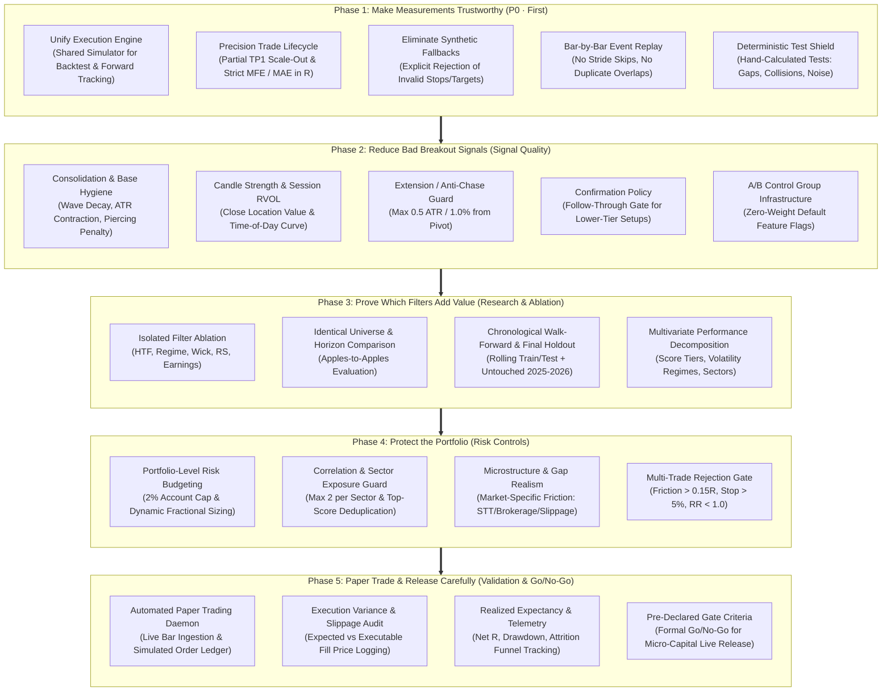

# 🏛️ Institutional Implementation Plan: Production-Grade Breakout System

> **Scope:** High-rigor engineering and quantitative validation roadmap for the Breakout Scanner engine.  
> **Target System:** End-to-end signal discovery, quantitative scoring, backtest simulation, risk allocation, and live paper execution.  
> **Guiding Principle:** **Measurements must be flawless before signals are tuned.** Every filter must justify its inclusion through empirical out-of-sample evidence. Risk controls must protect the aggregate portfolio, not merely individual trades.

---

## 🗺️ Five-Phase Architectural Blueprint

---

## 📌 Phase 1 — Make the Measurements Trustworthy
> **Priority:** P0 · First  
> **Deliverable:** A reliable, zero-bias baseline execution and measurement engine.  
> **Done When:** The exact same historical trade produces identical entry, partial exit, trailing stop, MFE/MAE, and net-R results across the backtester, post-scan analyzer, and noise reports.

### 1.1 Unify Forward Analyzer and Backtester Execution Core
* **Current Vulnerability:** [`Backtester`](breakout_scanner/backtester.py) and [`PostScanAnalyzer`](tools/post_scan_analyzer.py) maintain separate simulation routines. Slight divergences in trailing mechanics, same-bar conflict resolution, or friction deductions introduce reporting discrepancy.
* **Architecture Change:**
  - Create a unified simulation kernel: `breakout_scanner/simulation/engine.py` (or consolidate in `Backtester`).
  - Standardize trade state transitions into an immutable cycle:
    $$\text{IDLE} \longrightarrow \text{TRIGGERED} \longrightarrow \text{FILLED} \longrightarrow \text{TP1\_PARTIAL} \longrightarrow \text{CLOSED (STOP / TP2 / TIME\_EXIT)}$$
  - Both `run_backtest.py` and `post_scan_analyzer.py` call the identical execution simulator functions.

### 1.2 Correct Partial Exits and MFE/MAE Calculations
* **Partial Scale-Out Modeling:**
  - Upon touching $\text{TP1}$ ($\text{High} \ge \text{TP1}$ for longs, $\text{Low} \le \text{TP1}$ for shorts):
    - Close exactly $50\%$ of position at $\text{TP1}$ price adjusted for slippage.
    - Move stop-loss of remaining $50\%$ to exact breakeven ($\text{Entry Price}$).
    - Continue trade until remaining $50\%$ hits $\text{TP2}$, trailing stop, or time exit.
* **Normalized Risk-Adjusted Excursion ($R$-Multiple):**
  - Define initial structural risk: $R_{\text{initial}} = |\text{Entry Fill} - \text{Initial Stop}|$.
  - Compute MFE and MAE continuously across all bars held:
    $$\text{MFE}_R = \max_{t \in [t_{\text{entry}}, t_{\text{exit}}]} \left( \frac{\text{Direction} \times (\text{High}_t - \text{Entry})}{R_{\text{initial}}} \right)$$
    $$\text{MAE}_R = \max_{t \in [t_{\text{entry}}, t_{\text{exit}}]} \left( \frac{\text{Direction} \times (\text{Entry} - \text{Low}_t)}{R_{\text{initial}}} \right)$$
  - Net Realized $R$ must reflect weighted blended scale-outs minus friction:
    $$R_{\text{net}} = \frac{\text{Net Cash P&L}}{\text{Dollar Risk at Inception}}$$

### 1.3 Remove Synthetic Stop & Target Fallbacks
* **Zero Guesswork Policy:**
  - Remove all fallback approximations (such as `entry * 0.98` or `entry + abs(...)`) in `PostScanAnalyzer` and `BreakoutEngine`.
  - If a setup fails to calculate a structural support pivot or valid ATR stop:
    - Mark setup state as `INVALID_SETUP` with reject reason `MISSING_STRUCTURAL_STOP`.
    - Drop from trade slate completely. Never fabricate synthetic $2\%$ stops.

### 1.4 Bar-by-Bar Replay Engine (No Missing Triggers, No Double Counts)
* **Replay Integrity:**
  - Deprecate arbitrary bar strides (`stride_bars = 10` or `25`) in historical outcome evaluators.
  - Evaluate chronologically bar-by-bar:
    - When a valid breakout triggers at Bar $t$, simulate entry at Bar $t+1$ Open.
    - Lock symbol as `ACTIVE_IN_POSITION`.
    - Suppress subsequent breakout triggers on the same symbol until the active trade reaches terminal closure.

### 1.5 Deterministic Hand-Calculated Test Cases
* **Test Suite Expansion (`tests/test_execution_integrity.py`):**
  - **Overnight Gap Tests:** Bar opens below stop loss $\implies$ fill at Open (slippage), not at stop price.
  - **Overnight Gap Profit:** Bar opens above TP1 $\implies$ fill partial scale-out at Open.
  - **Same-Bar Collision:** Single candle breaches both Stop and TP1 $\implies$ strictly prioritize Stop (pessimistic fill).
  - **Zero / Negative / NaN Bar Ingestion:** Assert zero division guards and graceful handling.

---

## 📌 Phase 2 — Reduce Bad Breakout Signals
> **Focus:** Signal Quality & Setup Hygiene  
> **Deliverable:** Fewer, cleaner, higher-conviction candidates.  
> **Done When:** A frozen A/B evaluation against the control baseline demonstrates reduced losing trades and increased expectancy ($E(R)$) without killing opportunity frequency ($> 50\%$ candidate retention).

### 2.1 Consolidation Base Quality & False-Breakout Memory
* **Consolidation Health Index:**
  - Measure wave decay: sequential volatility contraction across waves ($C_3 < C_2 < C_1$).
  - Measure ATR contraction ratio ($\text{ATR}_{14} / \text{Price}$ at lowest quartile of 60-bar range).
* **Piercing Penalty (False Breakout Memory):**
  - Scan the 20-bar base for prior upper wick piercings ($\text{High} > \text{Resistance}$ followed by $\text{Close} < \text{Resistance}$).
  - Deduct $5$ points per failed piercing (cap at $-10$ pts) or reject if $> 2$ failed attempts in the same base.

### 2.2 Candle Close Strength & Session-Aware RVOL
* **Close Location Value (CLV / Upper Close):**
  $$\text{CLV} = \frac{\text{Close} - \text{Low}}{\text{High} - \text{Low}}$$
  - **Long:** Require $\text{CLV} \ge 0.65$ on breakout bar (reject shooting stars / severe upper wicks).
  - **Short:** Require $\text{CLV} \le 0.35$ on breakdown bar (reject hammers / strong lower wicks).
* **Session-Aware Intraday Volume (Intraday U-Curve):**
  - Instead of comparing hourly volume to a flat 20-period daily mean:
  - Benchmark volume against the *same time-of-day bucket* (e.g., 09:30–10:30 US or 09:15–10:15 NSE) over trailing 20 sessions to prevent midday false negatives and opening bell false positives.

### 2.3 Anti-Chase / Extension Guard
* **Chase Protection Thresholds:**
  - Compute entry distance from structural resistance:
    $$\Delta_{\text{pivot}} = \frac{\text{Current Price} - \text{Resistance}}{\text{Resistance}}$$
  - If $\Delta_{\text{pivot}} > \min(1.0\%, 0.5 \times \text{ATR}_{14})$:
    - Mark trade as `LATE_CHASE` / `EXTENDED`.
    - Prohibit market entry. Allow limit order resting at pivot or skip entirely.

### 2.4 Confirmation Rule for Borderline Setups
* **Tiered Confirmation Policy:**
  - **Grade A+ Setups (Score $\ge 90$):** Immediate next-bar Open entry.
  - **Grade B / C Setups (Score $70–84$):** Require confirmation candle:
    - Longs: Bar $t+1$ must print $\text{High} > \text{High}_t$ before trigger.
    - If confirmation fails within 2 bars, invalidate signal.

### 2.5 A/B Control Group Infrastructure
* **Strict Control Preservation:**
  - Implement all new filters behind configuration switches under `signal_quality` (default: `0.0` weight or `false`).
  - Run side-by-side comparative scans (`--experiment control_vs_quality`) on identical market datasets.

---

## 📌 Phase 3 — Prove Which Filters Add Value
> **Focus:** Quantitative Research & Empirical Ablation  
> **Deliverable:** Evidence-backed scoring parameters with validated out-of-sample edge.  
> **Done When:** Each retained feature proves positive incremental out-of-sample expectancy ($E(R)$) rather than merely cosmetic score inflation.

### 3.1 Isolated Single-Variable Filter Ablation
* **Ablation Matrix:**
  Test baseline against one isolated filter increment at a time:
  1. Baseline (VCP + 20 EMA + Breakout Volume)
  2. Baseline + CLV (Upper Close Location)
  3. Baseline + Intra-Base VDU Volume Slope
  4. Baseline + Multi-Timeframe 1D/4H Alignment
  5. Baseline + Benchmark RS Momentum Slope
  6. Baseline + Market Regime Volatility Attenuator
  7. Baseline + Earnings Proximity Filter

### 3.2 Standardized Evaluation Universe & Timelines
* **Data Harmonization:**
  - Evaluate on identical historical data blocks:
    - **US Tech 15:** `AAPL`, `NVDA`, `MSFT`, `AMZN`, `GOOGL`, `META`, `TSLA`, `AVGO`, `COST`, `CRM`, `CSCO`, `NFLX`, `AMD`, `QCOM`, `INTC`.
    - **NSE 15:** `RELIANCE.NS`, `TCS.NS`, `HDFCBANK.NS`, `INFY.NS`, `ICICIBANK.NS`, `BHARTIARTL.NS`, `SBIN.NS`, `LICI.NS`, `ITC.NS`, `HINDUNILVR.NS`, `LT.NS`, `BAJFINANCE.NS`, `HCLTECH.NS`, `MARUTI.NS`, `SUNPHARMA.NS`.

### 3.3 Chronological Walk-Forward & Untouched Holdout
* **Walk-Forward Splits:**
  - **In-Sample Train:** 2021-01-01 to 2023-12-31 (Feature tuning & weight calibration).
  - **Out-of-Sample Test (Walk-Forward):** 2024-01-01 to 2024-12-31 (Validation).
  - **Untouched Final Holdout:** 2025-01-01 to Present (Strict zero-contamination test).
* **Anti-Overfitting Criterion:**
  - Any parameter improvement in In-Sample that degrades Out-of-Sample $E(R)$ by $> 20\%$ is discarded as curve-fitting.

### 3.4 Multi-Regime Performance Decomposition
* **Performance Breakdown Table:**
  Report performance partitioned across:
  - **Macro Regime:** Bull Expansion ($\text{SPY} > \text{SMA50}$ & low ATR), Sideways Chop, Bear Breakdown ($\text{SPY} < \text{SMA50}$).
  - **Score Buckets:** $90–100$ (A+), $80–89$ (A), $70–79$ (B), $<70$ (C/Reject).
  - **Metrics Required:** Win Rate, Loss Rate, Profit Factor, Expectancy $E(R)$, Max Drawdown, Calmar Ratio, Average Holding Days.

---

## 📌 Phase 4 — Protect the Portfolio
> **Focus:** Institutional Risk Controls & Portfolio Management  
> **Deliverable:** Safe, automated trade selection and multi-position portfolio risk governance.  
> **Done When:** Risk limits enforce portfolio-level capital safety across multiple concurrent positions, eliminating single-trade and correlation blowups.

### 4.1 Portfolio-Level Risk Budgeting & Sizing
* **Account Sizing Parameters (`breakout_scanner/portfolio_guard.py`):**
  - **Total Account Equity:** $C_{\text{equity}}$ (e.g., \$100,000).
  - **Max Single-Trade Risk:** Fixed at $1.0\%$ of equity:
    $$\text{Position Size (Shares)} = \left\lfloor \frac{0.01 \times C_{\text{equity}}}{|\text{Entry Fill} - \text{Stop Loss}|} \right\rfloor$$
  - **Max Concurrent Positions:** Default $4$ open trades (maximum $4.0\%$ concurrent capital risk).
  - **Daily Total Risk Budget:** Hard ceiling at $2.0\%$ capital risk deployed in any single calendar day.

### 4.2 Sector Exposure & Correlation Clustering Guard
* **Sector Concentration Caps:**
  - Maximum capital allocated to any single industry sector: $25\%$ of portfolio value.
  - Maximum concurrent open trades in the same sector: $\le 2$ trades.
* **Intraday Correlation Stacking Gate:**
  - When multiple symbols from the same sector trigger simultaneously (e.g., `NVDA`, `AMD`, `QCOM` all breaking out on the same bar):
  - Do NOT open 3 correlated positions.
  - Select exclusively the single highest-scoring setup (`Grade A+`); suppress or queue the remainder.

### 4.3 Microstructure & Real-World Friction Realism
* **Market-Specific Cost Engines:**
  - **NSE Equity:** Include STT ($0.1\%$ delivery / $0.025\%$ intraday), Exchange Turnover, GST ($18\%$ on brokerage), SEBI turnover, and Stamp Duty.
  - **US Equity:** Include SEC fees, FINRA TAF, and exchange clearing costs.
  - **Dynamic Volatility Slippage:**
    $$\text{Slippage} = \max(\text{Fixed Base Pct}, 0.05 \times \text{ATR}_{14} / \text{Price})$$
* **Gap Risk Haircut:**
  - Apply empirical overnight gap slippage distribution on positions held across market closes.

### 4.4 Trade Rejection Gate
* **Automated Trade Disqualification:**
  - Reject immediately if:
    1. **Structural Risk Exceeded:** $(\text{Entry} - \text{Stop}) / \text{Entry} > 5.0\%$.
    2. **Friction Excessive:** Total round-trip costs $> 0.15R$ ($15\%$ of potential risk unit).
    3. **Unfavorable Payoff:** Distance to $\text{TP1} < 1.0 \times \text{Risk Distance}$ ($R:R < 1.0$).
    4. **Imminent Earnings:** Event scheduled within $\le 3$ trading sessions.

---

## 📌 Phase 5 — Paper Trade and Release Carefully
> **Focus:** Live Validation & Controlled Production Deployment  
> **Deliverable:** A documented, empirical go/no-go operational release.  
> **Done When:** Live paper execution matches backtest and research expectations over a minimum validation window with zero critical execution bugs.

### 5.1 Automated Paper Trading Daemon
* **Real-Time Shadow Execution:**
  - Run `BreakoutScanner` daemon during live market hours:
    - US Market: 09:30–16:00 EST.
    - NSE Market: 09:15–15:30 IST.
  - Ingest strictly closed, completed bars (anti-wick policy).
  - Emit virtual paper orders to simulated order ledger: `data/paper_trading/orders.jsonl`.

### 5.2 Execution Variance & Slippage Tracking
* **Slippage & Timing Audit:**
  - For each virtual fill, record:
    - $t_{\text{signal}}$: Timestamp candle closed.
    - $P_{\text{theoretical}}$: Theoretical breakout entry price.
    - $t_{\text{fill}}$: Next candle open timestamp.
    - $P_{\text{actual}}$: Realized executable open price.
    - Slippage delta: $\Delta_{\text{slip}} = P_{\text{actual}} - P_{\text{theoretical}}$.

### 5.3 Live Telemetry & Performance Attrition Ledger
* **Operational Telemetry (`data/paper_trading/performance_ledger.jsonl`):**
  - Track:
    - Total setups scanned vs emitted vs rejected.
    - Fill rate of actionable setups.
    - Realized win rate and net $R$-multiple.
    - Maximum observed paper portfolio drawdown.
    - Telegram alert latency and heartbeat status.

### 5.4 Pre-Declared Go/No-Go Release Criteria
* **Production Gate Checklist:**
  A transition to micro-capital live trading requires satisfying **all** criteria over a 30-day paper test (or minimum 40 completed trades):

| Metric | Minimum Required Gate | Fail / Re-work Action |
| :--- | :--- | :--- |
| **Net Realized Expectancy $E(R)$** | $\ge +0.20R$ per trade | Refine signal quality filters |
| **Realized Profit Factor** | $\ge 1.40$ | Review stop placement and scale-outs |
| **Max Paper Portfolio Drawdown** | $\le 5.0\%$ | Reduce daily risk budget or position caps |
| **Execution Slippage Variance** | Average slippage $\le 0.08R$ | Tighten spread filter or anti-chase limit |
| **Zero Critical Defects** | 0 uncaught exceptions or desyncs | Fix software stability |

---

## 📅 Execution Schedule & Milestone Tracking

| Phase | Core Milestone | Target Timeline | Verification Artifact |
| :---: | :--- | :---: | :--- |
| **Phase 1** | Unify Simulator, Fix Partial/MFE/MAE, Hand-Calculated Tests | Weeks 1–2 | `tests/test_execution_integrity.py` |
| **Phase 2** | CLV Wick Filter, Session RVOL, Anti-Chase, Control Group | Weeks 3–4 | `reports/ab_signal_quality_comparison.md` |
| **Phase 3** | Single-Filter Ablation, Chronological Walk-Forward OOS | Weeks 5–6 | `reports/ablation_research_study.md` |
| **Phase 4** | Portfolio-Level Risk Guard, Sector Caps, Friction Realism | Weeks 7–8 | `tests/test_portfolio_risk_budget.py` |
| **Phase 5** | 30-Day Paper Trading Daemon, Slippage Audit, Go/No-Go Gate | Weeks 9–12 | `reports/paper_trading_audit_report.md` |

