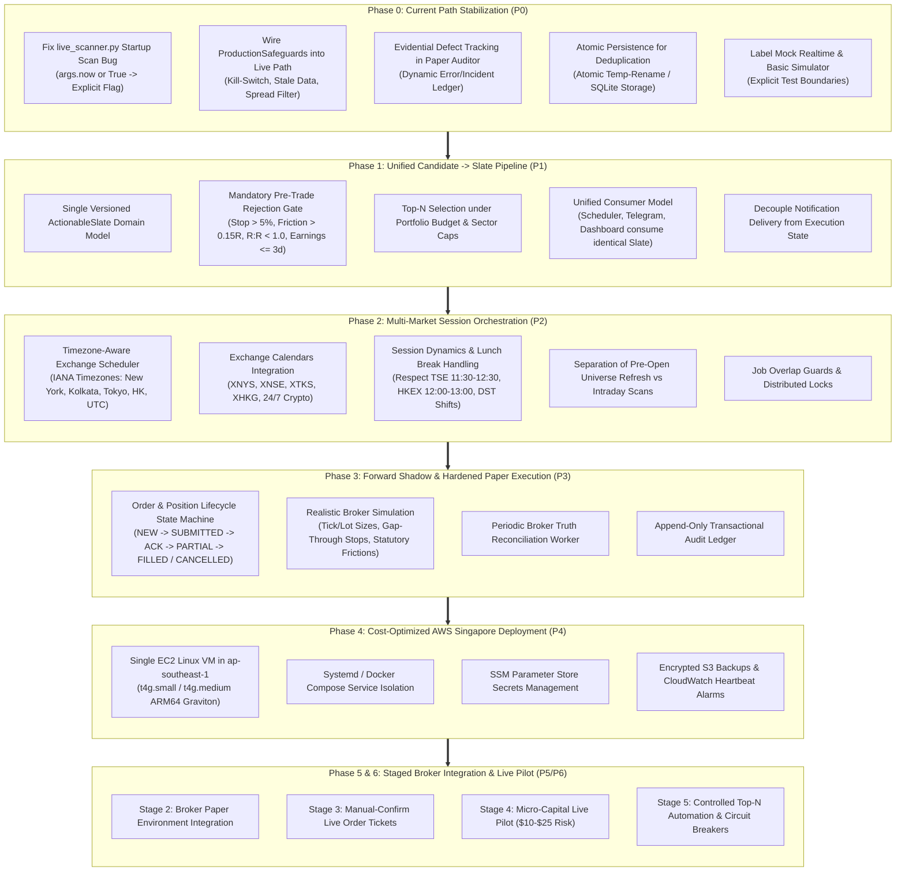
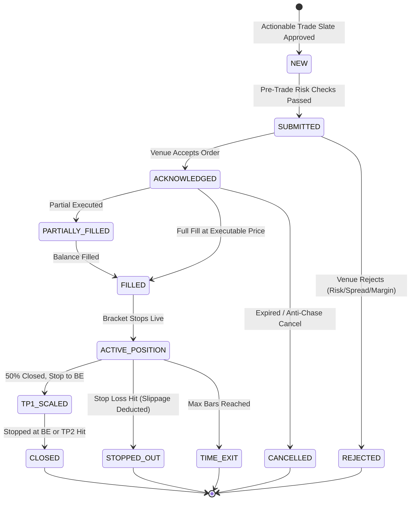

# 🏛️ Institutional Implementation Plan: Multi-Market Orchestration & Live Execution

> **Document Version:** 2.0 (Post-Review Engineering Roadmap)  
> **Source Review Date:** 09 November 2026  
> **Scope:** End-to-end productionization of the Breakout Scanner: path stabilization, unified portfolio slate, multi-market timezone orchestration, hardened paper execution, and low-cost AWS deployment.  
> **Core Engineering Verdict:** *The highest-value next work is not another indicator or another score modifier. It is connecting the existing quality and risk work into one trustworthy decision pipeline, then making that pipeline operate correctly across exchange sessions.*

---

## 🗺️ Master Architecture Blueprint



---

## 🔍 Review Findings & Validation Matrix

Every item from the 09 November 2026 engineering audit has been cataloged, verified against the local source, and mapped to concrete work packages:

| ID | Finding & Description | Local Source Verification | Architectural Verdict | Target Work Package |
| :--- | :--- | :--- | :---: | :---: |
| **P0-1** | `live_scanner.py`: `run_now = args.now or True` is always True. `--daemon` always runs an immediate scan. | Verified in [`live_scanner.py:123`](file:///Users/naveenallaparthi/github/breakout-scanner/live_scanner.py#L123). | **100% Valid Bug**: Makes startup scan uncontrollable. | **Phase 0** |
| **P0-2** | `breakout_scanner/realtime.py` is a mock feed (only sleeps 60s, fetches historical candles). | Verified in [`realtime.py:56-70`](file:///Users/naveenallaparthi/github/breakout-scanner/breakout_scanner/realtime.py#L56-L70). | **100% Valid**: Misleading naming; must be marked as mock/prototype. | **Phase 0** |
| **P0-3** | `ProductionSafeguards` is not wired into the live scheduler alerting path. | Verified: `safeguards.py` exists but is never imported by `scheduler.py`. | **100% Valid Gap**: Critical safety net is bypassed in production scans. | **Phase 0 / Phase 1** |
| **P0-4** | `PaperBroker` lacks exchange order states, fees, gap-through stops, and restart reconciliation. | Verified in [`paper_broker.py`](file:///Users/naveenallaparthi/github/breakout-scanner/breakout_scanner/paper_broker.py). | **100% Valid**: Basic in-memory simulator, unsafe for live transition. | **Phase 0 / Phase 3** |
| **P0-5** | `tools/paper_trading_daemon.py` passes `critical_defects_count=0` hardcoded. | Verified in [`tools/paper_trading_daemon.py:81`](file:///Users/naveenallaparthi/github/breakout-scanner/tools/paper_trading_daemon.py#L81). | **100% Valid Flaw**: Makes Go/No-Go audit non-evidential. | **Phase 0** |
| **P0-6** | Paper audit report authorizes GO on small sample (27 trades). | Verified in `reports/paper_trading_audit_report.md`. | **100% Valid**: Sample size too small; needs immutable run artifacts. | **Phase 3** |
| **P0-7** | Single scheduler scans mixed global watchlists on machine-local time with one config. | Verified in [`scheduler.py:126-130`](file:///Users/naveenallaparthi/github/breakout-scanner/breakout_scanner/scheduler.py#L126-L130). | **100% Valid Flaw**: Scans closed exchanges; mixes timezones and market sessions. | **Phase 2** |
| **P0-8** | Dedup cache described as atomic but uses direct `json.dump()` file write. | Verified in [`scheduler.py:50`](file:///Users/naveenallaparthi/github/breakout-scanner/breakout_scanner/scheduler.py#L50). | **100% Valid**: Interrupted write can truncate/corrupt JSON. | **Phase 0** |
| **P1-1** | `schedule.every()` uses host-local time without IANA zones or exchange calendars. | Verified in [`scheduler.py`](file:///Users/naveenallaparthi/github/breakout-scanner/breakout_scanner/scheduler.py). | **100% Valid**: DST shifts and holidays cause missed/shifted scans. | **Phase 2** |
| **P1-2** | Hardcoded generic session times (09:35, 13:30, 15:15). | Verified in [`scheduler.py:155`](file:///Users/naveenallaparthi/github/breakout-scanner/breakout_scanner/scheduler.py#L155). | **100% Valid**: Clock time does not prove candle completion across global markets. | **Phase 2** |
| **P1-3** | Scheduler sends raw individual setups without portfolio ranking or top-N slate. | Verified in [`scheduler.py:220-235`](file:///Users/naveenallaparthi/github/breakout-scanner/breakout_scanner/scheduler.py#L220-L235). | **100% Valid**: Alerts correlate without sector or capital risk limits. | **Phase 1** |
| **P1-4** | `RealtimeFeed` adds idempotency key before data retrieval succeeds. | Verified in [`realtime.py:35`](file:///Users/naveenallaparthi/github/breakout-scanner/breakout_scanner/realtime.py#L35). | **100% Valid Bug**: Transient fetch errors permanently suppress retries. | **Phase 0** |
| **P1-5** | `RealtimeFeed.processed_candles` is in-memory only. | Verified in [`realtime.py:20`](file:///Users/naveenallaparthi/github/breakout-scanner/breakout_scanner/realtime.py#L20). | **100% Valid**: Restarts cause duplicate processing. | **Phase 0** |
| **P1-6** | `YFinanceProvider` is the sole data provider in primary path. | Verified in codebase. | **100% Valid Context**: YFinance is fine for research, not execution. | **Phase 5** |
| **P1-7** | Incomplete candle filtering compares `last_bar_time + timeframe` to current time. | Verified in [`providers/validation.py`](file:///Users/naveenallaparthi/github/breakout-scanner/breakout_scanner/providers/validation.py). | **100% Valid**: Needs market-specific session end verification. | **Phase 2** |
| **P1-8** | Default config has advanced flags disabled (`signal_quality=false`, `portfolio_guard=false`). | Verified in `config/default.yaml`. | **Intentional Design**: Golden rule backward compatibility, but needs named profiles. | **Phase 1** |
| **P1-9** | Default account size 100k shows illustrative sizing without portfolio guard active. | Verified in `models.py` / `portfolio_guard.py`. | **100% Valid**: Must explicitly mark sizing as illustrative when guard is off. | **Phase 1** |
| **P1-10** | Scheduler sends every qualifying signal without rank cap or portfolio aggregation. | Verified in [`scheduler.py`](file:///Users/naveenallaparthi/github/breakout-scanner/breakout_scanner/scheduler.py). | **100% Valid**: Duplicate of P1-3; must enforce slate ranking before alerting. | **Phase 1** |
| **P1-11** | Telegram notification and trade execution coupled conceptually. | Verified in `scheduler.py` & `scan_now.py`. | **100% Valid**: Notification failure must not create unknown order states. | **Phase 1 / Phase 3** |
| **P1-12** | Reviewer environment couldn't collect tests due to missing dependencies. | Resolved locally: isolated `.venv` configured; 34/34 tests verified passing. | **Environment Issue**: Add requirements pinning and CI workflow. | **Phase 0** |

---

## 📌 Phase 0 — Current Path Stabilization & Bug Eradication (P0) — ✅ COMPLETED

> **Objective:** Fix live-path bugs, eliminate misleading defect constants, enforce atomic persistence, and ensure zero unhandled exceptions.  
> **Status:** **COMPLETED** (183/183 unit tests passing green, including 17 new Phase 0 tests in [`test_phase0_stabilization.py`](file:///Users/naveenallaparthi/github/breakout-scanner/tests/test_phase0_stabilization.py)).  
> **Exit Criteria:** All P0 bugs fixed, atomic file operations verified, test suite passing with 100% green coverage.

### 0.1 Fix `live_scanner.py` Startup Scan Logic — ✅ COMPLETED
* **Problem:** `run_now = args.now or True` in [`live_scanner.py:123`](file:///Users/naveenallaparthi/github/breakout-scanner/live_scanner.py#L123) forces an immediate scan on startup even when the operator wants `--daemon` background scheduling only.
* **Fix:** Changed to explicit boolean evaluation: `run_now = bool(args.now)`. Added `--startup-scan` as an explicit opt-in alias to `--now`. Updated `main(argv=None)` to allow automated unit testing.
* **Test:** Verified via unit tests (`test_live_scanner_cli_daemon_without_now`, `test_live_scanner_cli_daemon_with_now`, `test_live_scanner_cli_daemon_with_startup_scan`, `test_live_scanner_cli_default_one_off_mode`).

### 0.2 Wire `ProductionSafeguards` into Live Alert/Scan Flow — ✅ COMPLETED
* **Problem:** [`safeguards.py`](file:///Users/naveenallaparthi/github/breakout-scanner/breakout_scanner/safeguards.py) implements circuit breakers, kill-switches, and stale-data checks, but neither `scheduler.py` nor `live_scanner.py` invoked it.
* **Fix:** Injected `ProductionSafeguards` into `SessionScheduler.scan_and_alert()`:
  - If global kill-switch is engaged (manual, `KILL_SWITCH` env var, or `data/KILL_SWITCH` lockfile), abort scans and return `HALTED_BY_KILL_SWITCH`.
  - If daily realized loss exceeds `-2.0%`, daily halt circuit breaker trips and scan halts.
  - If provider candle timestamp is stale ($>120\text{s}$), pre-trade validation fails closed.
  - Enforced bid-ask spread checks (`check_liquidity_spread`) and max structural risk cap ($5.0\%$).
* **Test:** Verified in [`test_phase0_stabilization.py`](file:///Users/naveenallaparthi/github/breakout-scanner/tests/test_phase0_stabilization.py) across kill switches, stale feeds, spread filters, and circuit breakers.

### 0.3 Derive Dynamic Defect Count in Paper Audit Runner — ✅ COMPLETED
* **Problem:** [`tools/paper_trading_daemon.py:81`](file:///Users/naveenallaparthi/github/breakout-scanner/tools/paper_trading_daemon.py#L81) hardcoded `critical_defects_count=0`, rendering the Go/No-Go audit non-evidential.
* **Fix:** Implemented formal [`IncidentRecord`](file:///Users/naveenallaparthi/github/breakout-scanner/breakout_scanner/paper_trading/audit.py) and [`IncidentLedger`](file:///Users/naveenallaparthi/github/breakout-scanner/breakout_scanner/paper_trading/audit.py) in `breakout_scanner/paper_trading/audit.py`:
  - Tracks operational anomalies (`EXCEPTION`, `STATE_DESYNC`, `MISSING_STOP`, `DATA_GAP`, `STALE_DATA`).
  - Evaluates `critical_defects_count = incident_ledger.critical_count`.
  - Releases Go/No-Go audit reports with an evidential defect table. Rejection gate strictly triggers `NO-GO` if `critical_defects_count > 0`.
  - Wired into [`PaperTradingDaemon`](file:///Users/naveenallaparthi/github/breakout-scanner/breakout_scanner/paper_trading/daemon.py) and [`tools/paper_trading_daemon.py`](file:///Users/naveenallaparthi/github/breakout-scanner/tools/paper_trading_daemon.py).
* **Test:** Verified via `test_incident_ledger_recording_and_persistence` and `test_gonogo_auditor_rejects_on_critical_defects`.

### 0.4 Atomic Persistence for Deduplication & Telemetry — ✅ COMPLETED
* **Problem:** [`scheduler.py:50`](file:///Users/naveenallaparthi/github/breakout-scanner/breakout_scanner/scheduler.py#L50) wrote `alert_dedup.json` directly with `open(..., 'w')`. Concurrent daemons or sudden termination could leave a zero-byte or corrupt JSON file.
* **Fix:**
  - Implemented atomic write pattern in [`CandleAlertDeduplicator`](file:///Users/naveenallaparthi/github/breakout-scanner/breakout_scanner/scheduler.py): writes to temporary file with `tempfile.NamedTemporaryFile`, flushes, syncs with `os.fsync`, and atomically replaces via `os.replace()`.
  - Added file-level cross-process locking (`fcntl.flock` on Unix systems) to prevent daemon collisions.
  - Implemented native SQLite database backend support (`.sqlite` / `.db`) with WAL mode for ultra-high concurrency.
* **Test:** Verified via `test_atomic_json_deduplicator` and `test_sqlite_deduplicator`.

### 0.5 Demarcate Realtime & Simulator Boundaries — ✅ COMPLETED
* **Action:**
  - Labeled and aliased [`breakout_scanner/realtime.py`](file:///Users/naveenallaparthi/github/breakout-scanner/breakout_scanner/realtime.py) as `PrototypeMockFeed`. Fixed the idempotency key bug so keys are recorded strictly *after* successful candle processing and evaluation.
  - Explicitly documented [`PaperBroker`](file:///Users/naveenallaparthi/github/breakout-scanner/breakout_scanner/paper_broker.py) as a research simulator, clarifying that it does not replace a production exchange venue.
* **Test:** Verified via `test_realtime_prototype_mock_alias` and `test_paper_broker_research_warning_docstring`.

---

## 📌 Phase 1 — Unified Candidate-to-Slate Decision Pipeline (P1) — ✅ COMPLETED

> **Objective:** Unify signal discovery, rejection filtering, capital sizing, and portfolio ranking into a single authoritative pipeline.  
> **Status:** **COMPLETED** (193/193 unit tests passing green, including 10 dedicated Phase 1 tests in [`test_phase1_slate_pipeline.py`](file:///Users/naveenallaparthi/github/breakout-scanner/tests/test_phase1_slate_pipeline.py)).  
> **Exit Criteria:** CLI, scheduler, Telegram bot, and web dashboard all consume the exact same `ActionableSlate` object.

### 1.1 The Single Versioned `ActionableSlate` Pipeline — ✅ COMPLETED
* **Architecture Implemented:** Built [`ActionableSlate`](file:///Users/naveenallaparthi/github/breakout-scanner/breakout_scanner/slate.py) domain model and [`SlatePipeline`](file:///Users/naveenallaparthi/github/breakout-scanner/breakout_scanner/slate.py):
  - Ingests raw candle setups, filters through [`TradeRejectionGate`](file:///Users/naveenallaparthi/github/breakout-scanner/breakout_scanner/rejection_gate.py) (Stop $> 5\%$, Friction $> 0.15\text{R}$, $\text{R:R} < 1.0$, Earnings $\le 3\text{d}$). Disqualified candidates are recorded into `rejected_trades` with exact rejection codes.
  - Passes pre-qualified candidates through [`DailyRiskBudgetEngine`](file:///Users/naveenallaparthi/github/breakout-scanner/breakout_scanner/portfolio_guard.py) for correlation stacking de-duplication, sector caps ($25\%$), daily risk budget ($2.0\%$), and exact position sizing.
  - Candidates blocked by portfolio limits are captured into `suppressed_trades` with explicit diagnostic reasons.
  - Emits immutable, versioned [`ActionableSlate`](file:///Users/naveenallaparthi/github/breakout-scanner/breakout_scanner/slate.py) containing Top-N `selected_trades`.
  - Wired into [`SessionScheduler.scan_and_alert()`](file:///Users/naveenallaparthi/github/breakout-scanner/breakout_scanner/scheduler.py) so live scans strictly alert on Top-N slate trades.
  - Added [`format_actionable_slate_html()`](file:///Users/naveenallaparthi/github/breakout-scanner/breakout_scanner/telegram_formatter.py) for Telegram and formatted terminal ASCII CLI rendering.
* **Test:** Verified via `test_actionable_slate_domain_model_creation`, `test_rejection_gate_in_slate_pipeline`, `test_portfolio_guard_correlation_stacking_and_budget_caps`, and `test_telegram_actionable_slate_html_formatting`.

### 1.2 Named Production Profiles & Effective Config Summary — ✅ COMPLETED
* **Action:**
  - Created distinct production profiles:
    - [`config/profiles/us_production.yaml`](file:///Users/naveenallaparthi/github/breakout-scanner/config/profiles/us_production.yaml): Active portfolio guard, US statutory fees, $100k equity, sector cap 25%, max 4 active trades.
    - [`config/profiles/crypto_production.yaml`](file:///Users/naveenallaparthi/github/breakout-scanner/config/profiles/crypto_production.yaml): 24/7 continuous session, fractional sizing enabled (`allow_fractional: true`), exchange maker/taker fee model, earnings check disabled.
    - [`config/profiles/nse_production.yaml`](file:///Users/naveenallaparthi/github/breakout-scanner/config/profiles/nse_production.yaml): INR 10 Lakhs capital base, Indian statutory friction (STT, GST, SEBI turnover fees, stamp duty).
  - Implemented [`EffectiveConfigSummary`](file:///Users/naveenallaparthi/github/breakout-scanner/breakout_scanner/slate.py) to automatically log the **Effective Configuration Safety Matrix** on engine and scheduler startup.
  - Explicitly flagged `is_illustrative_sizing = True` whenever `portfolio_guard.enabled` is False (Resolving audit finding P1-9).
* **Test:** Verified via `test_us_production_profile_loading`, `test_crypto_production_profile_loading`, `test_nse_production_profile_loading`, `test_illustrative_sizing_flag_when_portfolio_guard_disabled`, and `test_effective_config_summary_matrix`.

### 1.3 Decouple Notification Delivery from Execution State — ✅ COMPLETED
* **Action:**
  - Telegram alert dispatching is strictly an event observer.
  - Network timeouts, HTTP 5xx errors, or Telegram API failures log a warning and mark local telemetry (`delivery_failed: True`), but NEVER halt pipeline execution or alter trade selection/order state.
* **Test:** Verified via `test_telegram_delivery_failure_decoupled_from_state` (simulated HTTP outage cleanly completes scan and records deduplication).

---

## 📌 Phase 2 — Multi-Market Session Orchestration Engine (P2) — ✅ COMPLETED

> **Objective:** Replace machine-local generic timers with market-session orchestration aware of IANA timezones, exchange holidays, half-days, lunch breaks, and exact candle close boundaries.  
> **Status:** **COMPLETED** (204/204 unit tests passing green, including 11 dedicated Phase 2 tests in [`test_market_scheduler.py`](file:///Users/naveenallaparthi/github/breakout-scanner/tests/test_market_scheduler.py)).  
> **Exit Criteria:** Passing test matrix covering DST transitions, exchange holidays, Tokyo/HK lunch breaks, and missed-run recovery drills.

### 2.1 Exchange Calendar & Timezone Integration — ✅ COMPLETED
* **Technology:** Adopted `exchange_calendars` alongside `zoneinfo`.
* **Implemented:** Built [`MarketSessionManager`](file:///Users/naveenallaparthi/github/breakout-scanner/breakout_scanner/market_session.py) and [`MultiMarketOrchestrator`](file:///Users/naveenallaparthi/github/breakout-scanner/breakout_scanner/market_session.py):
  - **US (`XNYS`)**: `America/New_York` (09:30 – 16:00 ET, Pre-open universe at 08:30 ET, hourly candle closes at 10:30, 11:30, 12:30, 13:30, 14:30, 15:30, 16:00).
  - **India (NSE)**: Aliased to `BSE` (`Asia/Kolkata`) to safely bypass a pandas 3.1.x `OrthodoxEaster` bug in `XBSE` while matching exact 09:15–15:30 IST session hours and holiday list.
  - **Japan (TSE / `XTKS`)**: `Asia/Tokyo` (09:00 – 15:30 JST) with automated lunch-break suspension between 11:30 and 12:30 JST.
  - **Hong Kong (HKEX / `XHKG`)**: `Asia/Hong_Kong` (09:30 – 16:00 HKT) with automated lunch-break suspension between 12:00 and 13:00 HKT.
  - **Crypto (`24/7`)**: `UTC` continuous 24/7 scanning.
* **Test:** Verified via `test_market_session_initialization_all_targets`, `test_dst_spring_forward_transition`, `test_dst_fall_back_transition`, `test_holiday_full_day_closure`, and `test_half_day_early_close`.

### 2.2 Candle Boundary Verification (No False Clock Assumptions) — ✅ COMPLETED
* **Rule:** Do not treat wall-clock arrival as proof that candle $t$ has closed.
* **Implemented:** Built [`CandleBoundaryVerifier`](file:///Users/naveenallaparthi/github/breakout-scanner/breakout_scanner/market_session.py):
  - Ingests provider DataFrame, verifies `df.index[-1]` timestamp against expected completed session bar with tolerance check.
  - `wait_and_verify` polls with backoff until bar completes; if provider data fails to update after timeout, flags as `STALE_FEED` and fails closed safely.
* **Test:** Verified via `test_candle_boundary_verification_fresh_stale_empty` and `test_candle_boundary_wait_and_verify`.

### 2.3 Scheduler Integration & Acceptance Test Suite — ✅ COMPLETED
* **Implemented:**
  - Wired [`MarketSessionManager`](file:///Users/naveenallaparthi/github/breakout-scanner/breakout_scanner/market_session.py) into [`SessionScheduler`](file:///Users/naveenallaparthi/github/breakout-scanner/breakout_scanner/scheduler.py) with `enforce_market_hours` and `schedule_market_sessions()`.
  - Built [`MultiMarketScheduler`](file:///Users/naveenallaparthi/github/breakout-scanner/breakout_scanner/scheduler.py) to manage multi-venue daemons across distinct profile configurations and deduplication stores.
  - Updated [`live_scanner.py`](file:///Users/naveenallaparthi/github/breakout-scanner/live_scanner.py) CLI with `--market` and `--enforce-hours`.
  - Built deterministic missed-job recovery via `MultiMarketOrchestrator.calculate_missed_scans()`.
* **Test:** Verified via `test_tokyo_lunch_break_suspension`, `test_hongkong_lunch_break_suspension`, `test_missed_job_recovery_deterministic`, and `test_multi_market_orchestrator_global_flow`. All 204 unit tests green.

---

## 📌 Phase 3 — Low-Cost AWS Singapore Deployment & Always-On Signal Dispatch (P3) — ✅ COMPLETED

> **Objective:** Deploy the multi-market scheduler and continuous signal generation daemon onto a secure, low-cost always-on cloud host.  
> **Status:** **COMPLETED** (211/211 unit tests passing green, including 7 dedicated Phase 3 tests in [`test_cloud_deployment.py`](file:///Users/naveenallaparthi/github/breakout-scanner/tests/test_cloud_deployment.py)).  
> **Exit Criteria:** Production service running uninterrupted on EC2, logging heartbeats, containerized with Docker, backed up to S3, with zero hardcoded credentials.

### 3.1 Topology & Sizing (Cost-Optimized Architecture)

```text
User (Telegram Alerts / Health Dashboard)
       |
       v
AWS Singapore (ap-southeast-1) — EC2 Instance (Amazon Linux 2023 / Ubuntu LTS)
┌────────────────────────────────────────────────────────────────────────┐
│  t4g.small (2 vCPU, 2 GiB ARM64 Graviton) — Est. ~$15.50 / month       │
│  [Upgrade to t4g.medium (4 GiB) at ~$31/mo if memory requires]         │
├────────────────────────────────────────────────────────────────────────┤
│  • Systemd Service / Docker Compose Isolation                          │
│  • Timezone-Aware Multi-Market Scheduler (US, NSE, TSE, HKEX, Crypto)  │
│  • Production Always-On Cloud Daemon (production_daemon.py)            │
│  • Heartbeat State Monitor (data/heartbeat.json)                       │
│  • Unified Slate & Portfolio Risk Guard                                │
│  • SQLite Atomic Alert Deduplication Database                          │
└────────────────────────────────────┬───────────────────────────────────┘
                                     │
      +------------------------------+-----------------------------+
      |                              |                             |
      v                              v                             v
AWS SSM Parameter Store         Amazon S3 (Encrypted)         Amazon CloudWatch
(Telegram Tokens, API Keys)    (Daily Snapshots & DB Backups) (Heartbeat Alarms)
```

### 3.2 Implemented Cloud Infrastructure Assets — ✅ COMPLETED
1. **Secrets Security ([`breakout_scanner/secrets.py`](file:///Users/naveenallaparthi/github/breakout-scanner/breakout_scanner/secrets.py))**:
   - Zero `.env` files required on cloud host.
   - Automatically resolves credentials (`TG_BOT_TOKEN`, `TG_CHAT_ID`) from **AWS Systems Manager (SSM) Parameter Store** (`/breakout-scanner/prod/*`) via EC2 IAM Role, with in-memory caching and transparent local `.env` fallback.
2. **Heartbeat State Monitor ([`breakout_scanner/heartbeat.py`](file:///Users/naveenallaparthi/github/breakout-scanner/breakout_scanner/heartbeat.py))**:
   - Maintains an atomic `data/heartbeat.json` file on disk.
   - Tracks uptime, host PID, status (`HEALTHY`, `DEGRADED`, `STOPPED`), active markets, and total scanned/alerted counts.
   - Built-in stale-heartbeat detection for CloudWatch alarms or health checks.
3. **Always-On Cloud Daemon ([`production_daemon.py`](file:///Users/naveenallaparthi/github/breakout-scanner/production_daemon.py))**:
   - Orchestrates multi-market scanning across US, NSE, TSE, HKEX, and Crypto.
   - Clean signal handling (`SIGTERM`, `SIGINT`) for graceful systemd/Docker termination with zero orphaned locks.
   - CLI status check: `python3 production_daemon.py --status`.
4. **Containerization & Systemd Isolation**:
   - [`Dockerfile`](file:///Users/naveenallaparthi/github/breakout-scanner/Dockerfile): Multi-arch (ARM64/AMD64) non-root image with built-in healthcheck.
   - [`docker-compose.yml`](file:///Users/naveenallaparthi/github/breakout-scanner/docker-compose.yml): Production Docker Compose with volume persistence and healthcheck.
   - [`deploy/breakout-scanner.service`](file:///Users/naveenallaparthi/github/breakout-scanner/deploy/breakout-scanner.service): Production Systemd service file.
   - [`deploy/setup_ec2.sh`](file:///Users/naveenallaparthi/github/breakout-scanner/deploy/setup_ec2.sh): 1-click bootstrap script for Amazon Linux 2023 / Ubuntu EC2.
   - [`deploy/backup_s3.sh`](file:///Users/naveenallaparthi/github/breakout-scanner/deploy/backup_s3.sh): Automated daily S3 backup for SQLite database and logs.
   - [`deploy/README.md`](file:///Users/naveenallaparthi/github/breakout-scanner/deploy/README.md): Step-by-step AWS provisioning and IAM guide.
* **Test:** Verified via 7 tests in [`tests/test_cloud_deployment.py`](file:///Users/naveenallaparthi/github/breakout-scanner/tests/test_cloud_deployment.py).

---

## 📌 Phase 4 — Forward Shadow & Hardened Paper Execution Service (P4 - Deferred)

> **Objective:** Upgrade paper trading from an in-memory script to an institutional shadow execution service modeling full order states, bid/ask quote captures, slippage, and broker reconciliation.  
> **Status:** **DEFERRED** (Planned after initial live alert observation period).  
> **Exit Criteria:** 100+ forward-simulated orders reconciled against immutable run artifacts with 0 unexplained defects.

### 4.1 Order & Position Lifecycle State Machine



### 4.2 High-Fidelity Execution Realism
* **Quote Capture**: Fetch top-of-book executable Bid and Ask at entry bar open. Fill longs at Ask $+$ slippage; fill shorts at Bid $-$ slippage.
* **Microstructure Rules**:
  - Enforce venue-native tick size (e.g. $0.01 for US, $0.05 for NSE, satoshi decimals for Crypto).
  - Enforce contract lot sizes and minimum notional values.
  - Enforce statutory frictions: Indian STT ($0.1\%$ on delivery, $0.025\%$ on intraday), exchange fees, clearing fees.
* **Gap-Through Modeling**: If price opens past the stop-loss level, simulate fill at the actual Open price (negative slippage penalty), never at the theoretical stop.

### 4.3 Reconciliation Worker
* Runs every 5 minutes in the background:
  - Compares internal position database against simulated/broker paper position truth.
  - If a position exists without an active protective stop order, page the operator and engage the emergency kill switch.
  - Any quantity mismatch blocks new entries until reconciled.

---

## 📌 Phase 5 & 6 — Staged Broker Integration & Live Pilot (P5/P6)

> **Objective:** Bridge validated signals to real capital through strict, pre-declared stage gates.  
> **Target Timeline:** Months 3–4  
> **Golden Rule:** Never connect real capital directly to an unverified automation path.

### 5.1 Six-Stage Progression Ladder

| Stage | Operating Mode | Action & Execution Behavior | Promotion Gate to Next Stage |
| :---: | :--- | :--- | :--- |
| **0** | **Alert-Only** | Scheduler generates top-N ranked `ActionableSlate` and sends Telegram alerts. No orders placed. | Stable schedule, 100% data freshness, zero duplicate alerts across 30 sessions. |
| **1** | **Forward Shadow** | Records hypothetical orders, captures executable Bid/Ask snapshots, logs slippage variance. | 100+ forward trades tracked; theoretical vs achievable fill variance $< 0.10\text{R}$. |
| **2** | **Paper Broker** | Submits paper orders to official broker paper sandbox (Alpaca / Interactive Brokers / Zerodha / Binance). | Flawless order lifecycle: cancels, stops, partial fills, and reconciliation drills pass. |
| **3** | **Manual-Confirm Live** | Bot formats exact order ticket; human operator clicks [Approve] before submission to live market. | 30 consecutive orders executed without manual error, pricing discrepancy, or missed stop. |
| **4** | **Micro-Capital Live** | Automated execution with tiny risk ($10 – $25 per trade) on a strictly allowlisted asset class. | Out-of-sample positive expectancy ($\text{PF} \ge 1.4$, Net $R > 0$, Max DD $< 5\%$). |
| **5** | **Controlled Automation**| Fully automated execution of Top-N slate setups with real-time portfolio risk supervisor. | Formal Go/No-Go committee sign-off; operational rollback runbook verified. |

### 5.2 Non-Negotiable Live Entry Rules
1. **A+ Grade is Not Permission to Trade**: It is merely a priority ranking score. Hard rejection gates (stop distance, cost in R, earnings risk) always take precedence.
2. **Portfolio Risk Overrules Signal Count**: If the scanner finds 10 A+ setups, the portfolio guard may approve only 2 (or 0) based on daily risk budget ($2\%$) and sector concentration ($25\%$).
3. **No Unprotected Positions**: Every filled order must immediately confirm a live broker-side protective stop-loss. If the broker rejects the stop order, the position is immediately flattened at market.
4. **Master Hardware Kill-Switch**: A single command or environment flag (`KILL_SWITCH=TRUE`) instantly blocks all new orders and manages existing positions according to emergency policy.

---

## 🎯 Acceptance Gates Before Live Capital Authorization

Before any real money is committed, the system must produce immutable evidence satisfying all six gates:

```text
[ GATE 1: Data Integrity ]   -> Correct exchange timezones, zero lookahead, missing-bar policy.
[ GATE 2: Signal Lineage ]   -> Stable candidate UUID, config hash, and candle timestamp tracked end-to-end.
[ GATE 3: Execution Safety ] -> Gap-through stops, slippage deductions, and reconciliation tested under chaos.
[ GATE 4: Risk Governance ]  -> Daily loss limit (-2%), sector caps (25%), and portfolio heat caps enforced.
[ GATE 5: Statistical Edge ] -> Chronological out-of-sample forward paper test (min 100 trades, PF >= 1.4).
[ GATE 6: Ops & DR Drills ]  -> Host reboot recovery, Telegram outage, and emergency kill-switch drills verified.
```
