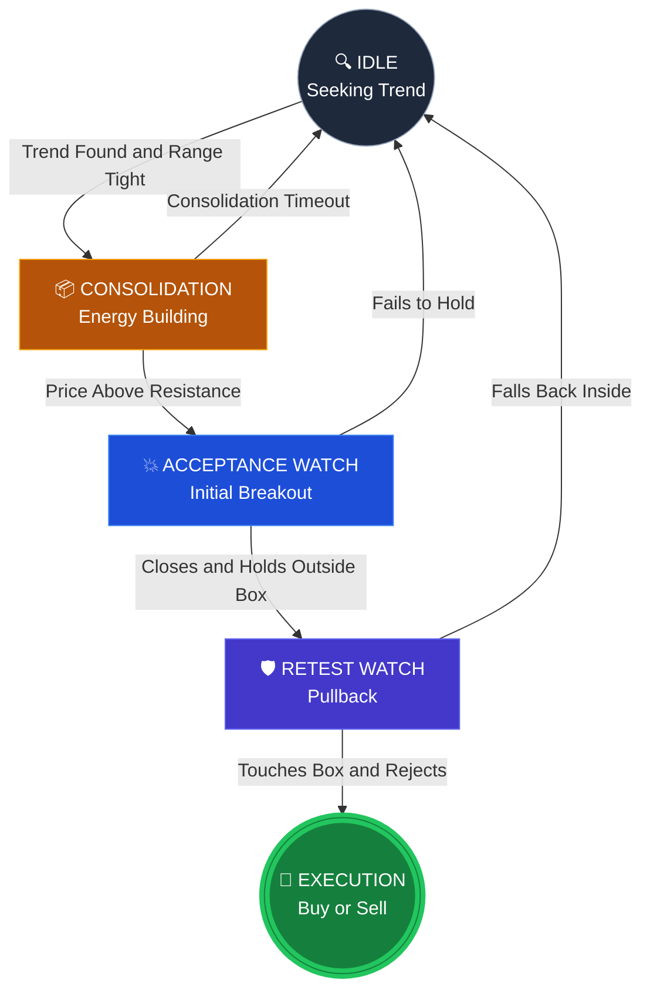

# Breakout Scanner Architecture

An institutional-grade, deterministic trading engine designed to isolate and execute high-probability structural breakouts across equities and crypto. The system strictly eliminates look-ahead bias and is backed by a robust Risk Engine, Paper Trading simulation, and Production Circuit Breakers.

> 📖 **Trader's Handbook**: For complete signal interpretation, diagnostic badges, and step-by-step decision rules, see [USAGE.md](USAGE.md).

## 🧠 System Architecture

The engine implements a strict state-machine flow inspired by Pine Script mechanics, migrating setups through rigorous validation checks.

`IDLE` → `CONSOLIDATION` → `ACCEPTANCE_WATCH` → `ACCEPTED_RETEST_WATCH` → `BUY/SELL`

### Trading Strategy (State Machine)


### Core Components
1. **The Breakout Engine (`engine.py`)**: The deterministic core. It computes ATR, Momentum, and Volume profiles bar-by-bar to evaluate structures.
2. **The Scanner (`scanner.py`)**: Manages the persistent memory state for N-symbols simultaneously.
3. **The Backtester (`backtester.py`)**: An event-driven historical simulation engine that loops bar-by-bar (O(N²)) to prevent any potential look-ahead bias.
4. **Risk Engine (`risk.py`)**: Calculates position sizing based on available account balance, risk per trade limits, and structural stop-losses.
5. **Paper Broker (`paper_broker.py`)**: A simulated execution environment that manages virtual balances, enforces maximum exposure constraints, and fills limit/stop orders.
6. **Production Safeguards (`safeguards.py`)**: The ultimate gatekeeper implementing Global Kill Switches, Daily Loss Limits, Liquidity checks, and Stale Data detection.
7. **The Dashboard (`dashboard.py`)**: A Flask-based Glassmorphism UI that visualizes real-time states and utilizes a "Prediction Chat" to explain exactly *why* the engine made a specific decision.

---

## ⚙️ Configuration (`config/default.yaml`)
All hyper-parameters are decoupled from the code and live in `default.yaml`. 

* **Structure**: Pivot lengths and trend validation.
* **Consolidation**: Maximum range percentages and time constraints.
* **Breakout**: Minimum push strength and volume anomalies required to trigger.
* **Risk**: Maximum daily drawdown, account exposure, and R:R ratios.

---

## 🚀 Execution Guide

### 1. Installation
```bash
python3 -m venv .venv
source .venv/bin/activate
pip install -r requirements.txt
```

### 2. Run the Local Dashboard
```bash
python3 dashboard.py
```
*Navigate to `http://127.0.0.1:5000` to view the UI.*

### 3. Run a Backtest
```bash
python3 run_backtest.py
```
*Results will automatically populate in the `/backtest` directory, generating equity curves, complete trade logs, and high-level `metrics.json`.*

### 4. Command Line Scanner
To run a one-off historical scan:
```bash
python3 -m breakout_scanner.cli scan --watchlist config/watchlist.txt --period 60d --interval 1h
```

---

## 🛡️ Safeguards & Phase 10 (Live Execution)
Before attaching live brokerage API keys (e.g., Alpaca, CCXT) for Phase 10, ensure that the `ProductionSafeguards` are correctly calibrated to your timezone and liquidity preferences. The engine is programmed to halt completely if daily loss limits are breached or data latency exceeds 120 seconds.

## Setup & Virtual Environment
```bash
# 1. Create a virtual environment
python3 -m venv .venv

# 2. Activate it
source .venv/bin/activate

# 3. Upgrade pip & install dependencies
pip install --upgrade pip
pip install -r requirements.txt
```

## Execution steps
The default input file where we store the stock names is located at: `config/watchlist.txt`

When you run `python3 daily_report.py` without any extra commands, it automatically reads the stock tickers from that specific file.

(Note: We also created `config/crypto_watchlist.txt` and `config/top30_watchlist.txt` earlier. If you want to use a different file, you just pass it in like this: `python3 daily_report.py --watchlist config/your_custom_file.txt`).

How to Apply It to Your Trading:
Prioritize Ultra-Tight Setups ($\le 4.5%$):
Look at AAPL (Width: 3.2%) vs ACN (Width: 12.3%).
AAPL is coiled like a compressed spring. When overhead supply dries up to just $3.2%$, even a small wave of buying volume will cause an explosive price surge.
ACN is still relatively loose ($12.3%$), meaning it may chop around inside the box a bit longer before taking off.
Cheaper Stops & Better $R:R$:
A $3.5%$ base width allows you to place a stop loss directly beneath the box with very low risk ($1% - 1.5%$), which lets you take a larger position size for the same dollar risk.

How to Apply It:
When you see TTWO | [Gaming/Media RS: +5.6%]:

It tells you TTWO is outperforming its entire media peer group by $+5.6%$ over the last 20 bars.
This proves institutional capital is actively rotating into TTWO above other media stocks.
If a stock is in a breakout, but its sector RS is negative (e.g. $-2%$), the stock is lagging its group and the breakout is more prone to stalling.

---

## 📊 1. The 5-Pillar Quantitative Scoring Matrix (0–100 Points)

All quantitative signals are aggregated into a single objective composite score via [breakout_scanner/scorer.py](breakout_scanner/scorer.py):

| Pillar | Focus | Max Points | Scoring Criteria |
| :--- | :--- | :---: | :--- |
| **1. Contraction Physics** | Coil Decay & Base Width | **20 pts** | • Base width $\le 4\%$ (10 pts), $\le 6.5\%$ (8 pts), $> 9\%$ (2 pts)<br>• Coil ratio $\le 0.40\times$ (10 pts), $\le 0.70\times$ (8 pts), uncontracted (2 pts) |
| **2. Volume Footprint** | Supply Exhaustion / Demand | **20 pts** | • **Bases**: VDU ratio $\le 0.60\times$ (20 pts), $\le 0.75\times$ (16 pts), $\le 0.90\times$ (11 pts)<br>• **Breakouts**: RVOL $\ge 2.0\times$ (20 pts), $\ge 1.5\times$ (17 pts), $\ge 1.2\times$ (14 pts) |
| **3. Multi-Timeframe Trend** | 1D Macro Confluence | **20 pts** | • 1D 50 SMA upward confluence ⭐ 1D (12 pts)<br>• 1H trend alignment (8 pts) |
| **4. Relative Strength Alpha** | Sector Benchmark Lead | **20 pts** | • Sector RS Delta $\ge +3.0\%$ (10 pts), $> 0.0\%$ (8 pts)<br>• Linear regression slope ↗ (10 pts), → (6 pts), ↘ (1 pt) |
| **5. Risk-Reward Asymmetry** | Stop Tightness & Invalidation | **20 pts** | • Risk/Width $\le 1.2\%$ (12 pts), $\le 2.0\%$ (9 pts), $> 3.0\%$ (2 pts)<br>• Clean confirmed pivot retest / crisp pattern geometry (8 pts) |

---

## 🏆 2. Tier Grading System

| Grade | Score Range | Classification | Actionable Trading Rule |
| :---: | :---: | :--- | :--- |
| **A+** | **90 – 100** | **Institutional "God-Tier"** | Ultra-tight coil, supply exhausted (VDU), 1D macro aligned, accelerating sector alpha. Maximum conviction / full size. |
| **A** | **80 – 89** | **High Conviction Breakout** | Excellent structure with strong institutional tailwinds. Standard full size. |
| **B** | **70 – 79** | **Playable Standard Setup** | Decent base, but either slightly wider width or neutral relative strength. Half size or tighter stop. |
| **C** | **< 70** | **Filtered / Sub-optimal** | Poor volume, loose coil, or counter-trend. Skip or avoid. |

---

## ⏱️ 3. Phase 2 Automated Session Scheduler & Daemon (Timing is Edge)

Breakouts are lost when entered late. The **Automated Session Scheduler** eliminates execution lag by running right as each hourly candle closes:

* **Background Daemon (`:01` past every hour)**: Wakes up 60 seconds after candle close, ensuring volume and OHLC finality across exchanges.
* **Instant Push Alert**: Delivers high-conviction signals straight to Telegram within 60–90 seconds of candle close.
* **Persistent Deduplication**: Generates atomic candle signatures (`SYMBOL:TYPE:CANDLE_TIME`) persisted in `data/alert_dedup.json` so your phone is **never spammed** with duplicate alerts for the same candle.
* **Heartbeat & System Logging**: Continuous tracking logged to `logs/scanner.log`.

```bash
# Start background daemon running at :01 past every hour
python3 live_scanner.py --daemon

# Start background daemon with additional NSE/US session milestones
python3 live_scanner.py --daemon --sessions

# Run an immediate one-off candle scan
python3 live_scanner.py --now

# Send a test instant push alert to your phone
python3 live_scanner.py --test-alert

# Clear deduplication cache
python3 live_scanner.py --clear-cache

# Monitor live daemon execution logs
tail -f logs/scanner.log

```

### Instant Push Alert Format
```text
🚨 FRESH BREAKOUT DETECTED: DOT-USD
Entry: 1.2815 | Stop: 1.2650 | Risk: 1.2% | Grade: B [79]
Triggered: Just now (1H candle close)
Direction: ▲ BUY [BREAKOUT] | Current Price: 1.2818
Targets: TP1: 1.3012 | TP2: 1.3209
[Crypto RS: +1.4% ↗] | Vol: 2.1x | ⭐ 1D Confirmed
```