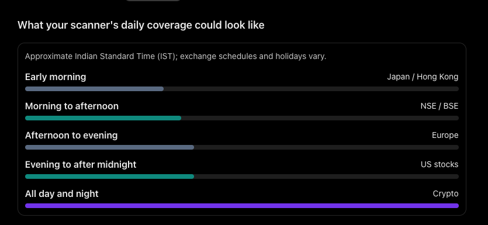

# Breakout Scanner – Multi-Market Coverage (IST & SGT)

| Market | Region | IST (UTC+5:30) | SGT (UTC+8) | Coverage |
|--------|--------|----------------|-------------|----------|
| 🇯🇵 Japan | Tokyo Stock Exchange | **05:30 – 11:30** | **08:00 – 14:00** | Early Morning |
| 🇭🇰 Hong Kong | HKEX | **07:00 – 13:00** | **09:30 – 15:30** | Early Morning |
| 🇮🇳 India | NSE / BSE | **09:15 – 15:30** | **11:45 – 18:00** | Morning → Afternoon |
| 🇬🇧 Europe | London Stock Exchange | **13:30 – 22:00** | **16:00 – 00:30** | Afternoon → Evening |
| 🇺🇸 US | NYSE / Nasdaq | **19:00 – 01:30** | **21:30 – 04:00** | Evening → After Midnight |
| ₿ Crypto | Binance / Coinbase / Bybit | **24/7** | **24/7** | All Day & Night |

---

## Daily Scanner Timeline

| Time Block | IST | SGT | Primary Market |
|------------|-----|-----|----------------|
| Early Morning | 05:30 – 13:00 | 08:00 – 15:30 | Japan & Hong Kong |
| Morning | 09:15 – 15:30 | 11:45 – 18:00 | NSE / BSE |
| Afternoon | 13:30 – 18:00 | 16:00 – 20:30 | Europe Opens |
| Evening | 19:00 – 22:00 | 21:30 – 00:30 | US + Europe Overlap |
| Late Night | 22:00 – 01:30 | 00:30 – 04:00 | US Session |
| Overnight | 01:30 – 05:30 | 04:00 – 08:00 | Crypto Only |

---

## Ideal Scan Frequency

| Market | Scan Interval |
|--------|---------------|
| Crypto | Every 1–5 minutes |
| NSE | Every 5 minutes (1h breakout evaluation on closed candles) |
| Japan / Hong Kong | Every 5 minutes |
| Europe | Every 5 minutes |
| US | Every 2–5 minutes |

# Breakout Scanner — Global Market Coverage

All times are shown in **IST (Indian Standard Time)** and **SGT (Singapore Time)**. Both time zones are UTC+5:30 and UTC+8:00 respectively, so **SGT is 2 hours 30 minutes ahead of IST**.

> **Important:** These are approximate regular trading-session times, not a guarantee that every instrument or exchange is open. Exchange holidays, daylight-saving changes, lunch breaks, and special sessions can change the schedule. Crypto markets generally trade 24/7.

| Market / Region | Example Exchanges / Instruments | Regular Session (Local Market Time) | Session in IST | Session in SGT | Scanner Coverage |
|---|---|---|---|---|---|
| Japan | Tokyo Stock Exchange equities | 09:00–11:30, 12:30–15:30 JST | 05:30–08:00, 09:00–12:00 | 08:00–10:30, 11:30–14:30 | Early morning |
| Hong Kong | Hong Kong Stock Exchange equities | 09:30–12:00, 13:00–16:00 HKT | 06:30–09:00, 10:30–13:30 | 09:00–11:30, 13:00–16:00 | Early morning to afternoon |
| India | NSE / BSE equities | 09:15–15:30 IST | 09:15–15:30 | 11:45–18:00 | Morning to afternoon |
| Europe — London | London Stock Exchange equities | 08:00–16:30 UK local time | Usually 12:30–21:00 during UK summer time; 13:30–22:00 during UK winter time | Usually 15:00–23:30 during UK summer time; 16:00–00:30 during UK winter time | Afternoon to evening |
| United States | NYSE / Nasdaq regular equities session | 09:30–16:00 US Eastern Time | Usually 19:00–01:30 next day during US daylight time; 20:00–02:30 next day during US standard time | Usually 21:30–04:00 next day during US daylight time; 22:30–05:00 next day during US standard time | Evening to after midnight |
| Crypto | Spot crypto (e.g., BTC / ETH) | 24 hours a day, 7 days a week | 00:00–24:00, every day | 02:30–02:30 next day, every day | All day and night |

## Suggested Scanner Priority

1. **NSE / BSE** — keep as the baseline because the existing scanner is already NSE-focused.
2. **US equities** — next major stock-market expansion; account for US daylight-saving changes and earnings events.
3. **BTC / ETH crypto** — adds genuine weekend and overnight coverage, but requires separate rules for crypto volatility, exchange liquidity, funding (for derivatives), and execution.
4. **Japan / Hong Kong / Europe** — add after validating data quality, market-specific rules, costs, and out-of-sample results.

## Implementation Notes

- Store all timestamps internally in UTC; display session schedules in IST and SGT.
- Use exchange calendars rather than hard-coded opening times.
- Distinguish regular trading hours from pre-market, after-hours, auctions, and special sessions.
- Use separate configurations and validation reports for each market; do not assume NSE settings transfer unchanged.
- Keep scanning continuously if desired, but only generate actionable alerts when the relevant market is open and the setup passes its rules.
- For crypto, specify the exchange and product (spot or derivatives), because liquidity and trading costs vary by venue.

## Time Zone Reference

| Time Zone | UTC Offset | Relationship |
|---|---:|---|
| IST — India Standard Time | UTC+05:30 | Reference time |
| SGT — Singapore Time | UTC+08:00 | 2 hours 30 minutes ahead of IST |
