# 🗺️ Breakout Scanner: Roadmap to A+ Institutional Grade
> **Document:** Future Implementation Plan & Validation  
> **Date:** 23 October 2026  
> **Goal:** A+ Quality: Lower Noise, Higher Win-Rate, Institutional Rigor  
> **Golden Rule:** Whatever is working today must continue to work tomorrow. All additions are additive, feature-flagged (default=0/disabled), and verified via shadow-mode logging.

---

## 1. Executive Validation & System Fit Analysis

### 🎯 Is This Review Helpful for Our System?
**Yes, exceptionally helpful.** 

The review comments provide the exact operational bridge needed to elevate our engine from its current state (a mathematically sound VCP engine with a 5-pillar quant scorer and a zero-lookahead backtester) to an **institutional-grade production setup**.

### 🔍 Current Capabilities vs. Review Target Gaps

| Review Recommendation | Current System State in Repo | Verdict & Action Required |
| :--- | :--- | :--- |
| **Phase 0: Baseline & Safety Net** | We have 64 unit tests, but no frozen "golden dataset snapshot" asserting zero candidate/score deviation across updates. | **High Value**: Build `tests/test_golden_regression.py` with frozen cached market data fixtures. |
| **Phase 1: Observability & Noise Map** | Discarded symbols are logged to stdout/log file, but there is no structured reject persistence or forward 5–10 bar MFE/MAE tracking. | **Critical Edge**: Implement structured reject telemetry (`data/reject_log.jsonl`) and forward outcome tracker (`post_scan_analyzer.py`). |
| **Phase 2.1: Volume Dry-Up Slope** | We measure aggregate 5-bar VDU ratio ($\le 0.75\times$), but not the intra-base volume curve (last 1/3 vs first 1/3 of base). | **Additive Score**: Add `vdu_slope_score` with default weight `0.0`. |
| **Phase 2.2: Breakout Candle Upper Close** | Breakouts require Close > Resistance and RVOL $\ge 1.2\times$, but do not penalize shooting star wicks closing in the bottom half. | **Immediate Win**: Add `candle_close_location` score bonus (rewarding closes in upper $25\%$ of the bar range). |
| **Phase 2.3: Continuous Tightness Scoring** | Bases qualify if width $\le 10\%$, scored in discrete bands ($4\%$, $6.5\%$). | **Additive**: Introduce continuous decay score for ultra-tight bases ($<3.5\%$) near pivot. |
| **Phase 2.4: False-Breakout Memory** | Base detection does not track if previous candles in the current base spiked above resistance and closed back inside. | **High Value**: Add soft score penalty (`failed_breakout_penalty`) to de-prioritize re-test chop. |
| **Phase 3: Market Regime & Context** | We have 1D 50 SMA confluence and sector relative strength, but no broad market volatility (VIX / regime) filter or earnings check. | **Additive**: Implement soft market regime dampener and optional earnings event warning. |
| **Phase 4: Dedicated Portfolio Guard** | Risk engine and shared portfolio exist, but live execution lacks an operational allocator separating candidate emission from account risk. | **New Module**: Implement `PortfolioGuard` layer to manage daily risk budgets, sector caps, and correlation stacking. |
| **Phase 5: Chaos Testing & Hardening** | Backtests run cleanly, but synthetic chaos tests (rate limits, zero liquidity, missing frames) have not been codified. | **Institutional Resilience**: Add chaos testing suite in `tests/test_chaos_resilience.py`. |

---

## 2. Six-Phase Implementation Blueprint

```mermaid
flowchart TD
    subgraph S0 ["Phase 0: Baseline & Safety Net (Week 1)"]
        A1["Freeze Golden Dataset Fixture (90d)"]
        A2["Regression Shield Test Suite"]
        A3["Candidate & Reject Telemetry Logger"]
    end

    subgraph S1 ["Phase 1: Observability & Noise Map (Weeks 1-2)"]
        B1["Structured Reject Persistence (.jsonl)"]
        B2["Forward 5-10 Bar Outcome Tracker"]
        B3["Weekly Noise & Attrition Report"]
    end

    subgraph S2 ["Phase 2: Signal Quality Layer (Weeks 2-4)"]
        C1["Wick Rejection / Upper-Close Bonus"]
        C2["Intra-Base VDU Slope (Last 1/3 vs First 1/3)"]
        C3["Base Piercing / Failed-Breakout Penalty"]
        C4["Shadow-Mode Weight Calibration"]
    end

    subgraph S3 ["Phase 3: Confluence & Regime Context (Weeks 4-6)"]
        D1["Multi-TF 4H Alignment Badge"]
        D2["Market Volatility / VIX Regime Attenuator"]
        D3["Earnings Proximity Indicator"]
    end

    subgraph S4 ["Phase 4: Portfolio Guard Layer (Weeks 6-8)"]
        E1["Actionable Allocation Engine"]
        E2["Sector Exposure & Correlation Caps"]
        E3["Daily Capital Risk Budgeting"]
    end

    subgraph S5 ["Phase 5: Validation & Hardening (Weeks 8-12)"]
        F1["Rolling Walk-Forward OOS Verification"]
        F2["Chaos & Data-Failure Test Suite"]
        F3["Operational Monitoring & Runbook"]
    end

    S0 --> S1 --> S2 --> S3 --> S4 --> S5
```

---

### 🔹 Phase 0: Baseline & Safety Net (Week 1) [COMPLETED]
* **Goal**: Freeze existing engine behavior to guarantee zero regression across all subsequent changes.
* **Actions**:
  1. **Golden Dataset Snapshot**:
     * Freeze 90 trading days of OHLCV data for 15 standard US tickers (`AAPL`, `NVDA`, `MSFT`, `AMZN`, etc.) and 5 NSE tickers (`RELIANCE.NS`, `TCS.NS`, etc.) in `tests/fixtures/golden_dataset/`.
  2. **Golden Regression Shield (`tests/test_golden_regression.py`)**:
     * Runs `scanner.py` and `scorer.py` against the frozen fixtures.
     * Asserts identical candidate lists, state transitions, grades, and composite scores within $\pm 0.01$ point tolerance.
  3. **Metrics Logger (`breakout_scanner/telemetry.py`)**:
     * Add non-invasive telemetry hook recording: scan timestamp, symbol count, `#READY`, `#BREAKOUT`, average score, and reject reason histogram.
* **Exit Criteria**: `pytest tests/test_golden_regression.py` passes 100% on every commit. *(Verified: 3/3 passed)*

---

### 🔹 Phase 1: Observability & Noise Map (Weeks 1–2) [COMPLETED]
* **Goal**: Map out exactly where false breakouts and low-quality alerts originate using real data instead of intuition.
* **Actions**:
  1. **Structured Reject Logging**:
     * In [`engine.py`](breakout_scanner/engine.py), capture reject reasons (`FAIL_TREND`, `LOOSE_RANGE`, `NO_VDU`, `LOW_RVOL`, `EXTENDED_FROM_PIVOT`, `HTF_COUNTER_TREND`) and write to `data/telemetry/reject_events.jsonl`.
  2. **Post-Scan Forward Outcome Tracker (`tools/post_scan_analyzer.py`)**:
     * For every emitted `READY` or `BREAKOUT` candidate, inspect the subsequent 5–10 bars:
       * Did price hit TP1 ($+1.0\text{R}$)?
       * Did price trigger the structural stop-loss?
       * Maximum Favorable Excursion (MFE in $R$) and Maximum Adverse Excursion (MAE in $R$).
  3. **Weekly Noise Report (`tools/generate_noise_report.py`)**:
     * Aggregates false-breakout rate by score bucket ($90+, 80-89, 70-79, <70$), base width, RVOL tier, and 1D macro badge.
* **Exit Criteria**: Generated Noise Report identifying the top 2 causes of setup attrition. *(Verified: tests/test_noise_analyzer.py 4/4 passed; noise_report.md generated)*

---

### 🔹 Phase 2: Signal Quality Layer (Core Noise Reduction) (Weeks 2–4) [COMPLETED]
* **Goal**: Systematically raise win rate and eliminate weak breakouts using additive score modifiers behind feature flags.
* **Targeted Increments**:
  1. **Breakout Candle Upper-Close Location**:
     * Compute close position within bar range:
       $$\text{Close Position} = \frac{\text{Close} - \text{Low}}{\text{High} - \text{Low}}$$
     * Award score points for closes in the upper $25\%$ ($\ge 0.70$). Penalize heavy upper wicks ($< 0.40$).
  2. **Intra-Base VDU Curve (Volume Slope)**:
     * Compare average volume of the final 1/3 of the base against the initial 1/3 of the base.
     * Award bonus points for systematic decay ($\text{Vol}_{\text{final}} / \text{Vol}_{\text{initial}} \le 0.70$).
  3. **Continuous Distance-to-Trigger Tightness**:
     * Award progressive bonus points for spring-tight setups ($\le 4.0\%$ base width) within $0.75\%$ of the breakout pivot.
  4. **Failed Breakout / Base Piercing Memory**:
     * Check if previous candles inside the active base pierced resistance and subsequently closed back inside. Apply a soft score deduction ($-5$ pts per failed pierce, max $-10$ pts).
* **Golden Rule Implementation Protocol**:
  1. New calculation implemented as pure functions in [`breakout_scanner/signal_quality.py`](breakout_scanner/signal_quality.py).
  2. Weights initialized to `0.0` in `config/default.yaml` (zero behavioral change).
  3. Run in shadow mode; compare ranking against baseline.
* **Exit Criteria**: $\ge 15\%$ reduction in false-breakout rate on identical evaluation universe without reducing valid signals by more than $10\%$. *(Verified: tests/test_phase2_signal_quality.py 8/8 passed)*

---

### 🔹 Phase 3: Confluence & Regime Context Layer (Weeks 4–6) [COMPLETED]
* **Goal**: Add macro and institutional alignment without choking setup frequency.
* **Actions**:
  1. **Multi-Timeframe 4H Confluence Badge**:
     * Complement the existing 1D 50 SMA confluence badge by resampling 1H bars into 4H candles and checking bullish alignment (4H EMA20 > EMA50 with positive slope). Badged with `⭐⭐ Multi-TF (1D+4H)`.
  2. **Market Regime Volatility Attenuator (Soft Filter)**:
     * When benchmark (`SPY`, `QQQ`, `^NSEI`) trades below its 50 SMA and 20-period ATR expands beyond $+2\sigma$ volatility band (high-volatility distribution):
       * Apply an additive soft score penalty (`regime_penalty_weight`, $-8$ pts when enabled).
  3. **Earnings Proximity Warning**:
     * Fetch upcoming earnings date. If earnings occur within 3 trading days, attach a `⚠️ Earnings in N days` warning flag and apply a modest score reduction (`earnings_penalty_weight`, $-5$ pts when enabled).
* **Exit Criteria**: Higher average score of winning setups vs. losing setups across mixed market regimes. *(Verified: tests/test_phase3_confluence.py 5/5 passed; total suite 84/84 passed)*

---

### 🔹 Phase 4: Risk & Portfolio Guard Layer (Weeks 6–8) [COMPLETED]
* **Goal**: Bridge signal output to live capital allocation without altering core scanner logic.
* **New Module ([`breakout_scanner/portfolio_guard.py`](breakout_scanner/portfolio_guard.py))**:
  * **Position Sizing Helper**: Converts risk percentage (e.g., $1.0\%$ account equity) and structural ATR stop into exact share/contract size.
  * **Daily Risk Budget Engine**: Enforces max concurrent active positions (e.g., max 4 trades), max risk per day ($2\%$), and max sector allocation ($25\%$ cap).
  * **Correlation Stacking Guard**: Detects if multiple signals belong to the same industry basket (e.g., 3 semiconductor names triggering simultaneously) and selects only the single highest-scoring setup (`Grade A+`).
* **Exit Criteria**: Scanner produces a daily actionable trade slate conforming strictly to predefined portfolio risk limits. *(Verified: tests/test_portfolio_guard.py 8/8 passed; total suite 92/92 passed)*

---

### 🔹 Phase 5: Validation & Hardening (Proof of A+) (Weeks 8–12) [COMPLETED]
* **Goal**: Prove superior risk-adjusted expectancy and operational bulletproofing.
* **Actions**:
  1. **Temporal Walk-Forward Verification ([`tools/walk_forward_oos.py`](tools/walk_forward_oos.py))**:
     * Rolling train/test splits comparing baseline vs. Phase 2 improved scoring on all golden fixture symbols.
     * Measures TP1 hit rate, Win Rate, Expectancy ($E(R)$), Average R, Profit Factor per window and globally.
     * Side-by-side verdict with improvement %. Run: `python3 tools/walk_forward_oos.py`
  2. **Chaos Testing Suite ([`tests/test_chaos_resilience.py`](tests/test_chaos_resilience.py))**:
     * 13-test suite covering: empty/tiny DataFrames, zero-volume holidays, NaN floods, extreme ATR spikes,
       negative prices, flat-line data, all-NaN volume, missing OHLCV columns, combined stress scenarios.
     * Discovered and **fixed** missing-column `KeyError` in `BreakoutEngine.run()` — now returns `State.IDLE` gracefully.
  3. **Heartbeat Monitor ([`tools/heartbeat_monitor.py`](tools/heartbeat_monitor.py))**:
     * Detects $N$ consecutive zero-candidate sessions (default: 3), sends Telegram alert, exits with code 1.
     * Cron-schedulable for automated monitoring every 4 hours during trading days.
  4. **Operational Runbook ([`RUNBOOK.md`](RUNBOOK.md))**:
     * Complete operator guide: startup checklist, daily scan procedure, scan output reading, trade slate workflow,
       heartbeat monitoring, emergency kill switch, weekly maintenance, log locations, and troubleshooting table.
* **Exit Criteria for A+ Claim**:
  * $100\%$ pass rate on all 105 tests including chaos suite. *(Verified)*
  * Golden Regression Shield 3/3 passing throughout all phases. *(Verified)*
  * Chaos suite confirms zero unhandled exceptions across all adversarial data conditions. *(Verified 13/13)*
  * Walk-forward OOS evaluator ready for empirical out-of-sample proof when live data accumulates.

---

## 3. Explicit "Do-Not-Do" Rules (Scope Protection)

To preserve system reliability and protect existing production capabilities:
1. **Never rewrite the core VCP engine in a single big-bang refactor.**
2. **Never turn confluence badges (1D / 4H / Sector RS) into binary kill-gates**—they must remain additive score factors.
3. **Never modify default score weights without a 1-to-2 week shadow-mode comparison.**
4. **Never delete existing unit tests or drop code coverage.**
5. **Never claim A+ grade without empirical out-of-sample statistical proof.**
