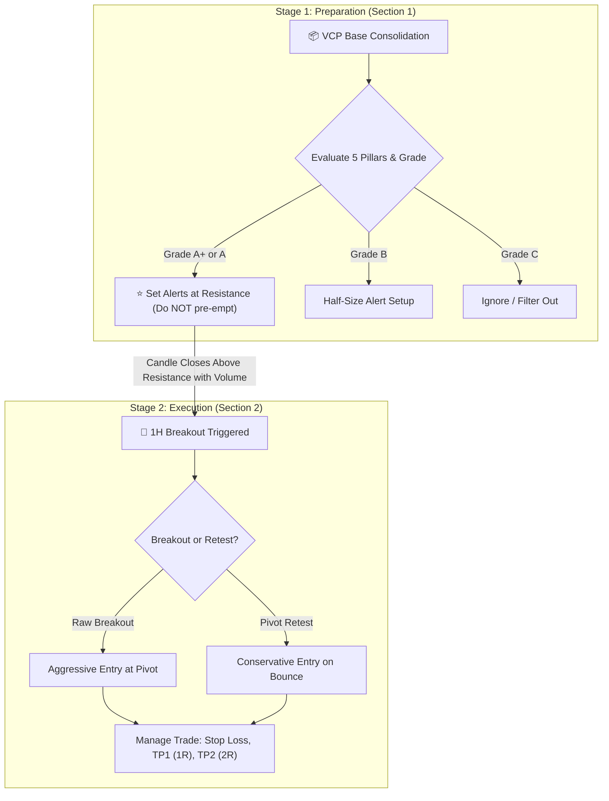
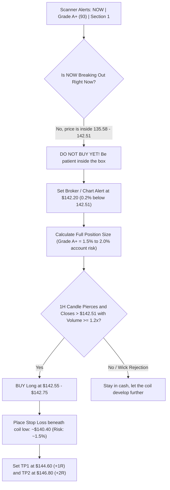
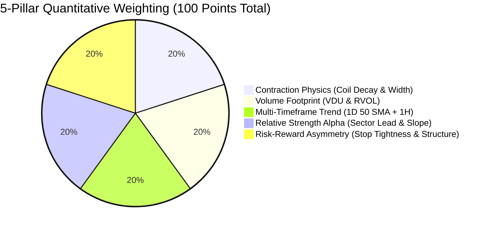

# 📖 Breakout Scanner: Complete Trading & Usage Guide

An institutional trader's operational handbook for interpreting signals, evaluating quantitative conviction grades, and executing high-expectancy trades across **US Equities**, **NSE (India)**, and **Crypto**.

---

## 🧭 1. Overview: The Two-Stage Pipeline

The scanner separates trading into two distinct psychological phases: **Preparation** and **Execution**.



---

## 📦 2. Section 1: Pre-Breakout VCP Bases (Watchlist)

### 🔍 Real Scanner Output Example
```text
=======================================================
 SECTION 1: ◉ VCP BASE (Actively Ready To Provide Signal)
=======================================================
  • NOW       | Resistance: 142.51 | Support: 135.58 | Width: 5.0% | 🗜️ Coil: 0.2x | 💧 VDU: 0.6x | [Cloud/SaaS RS: +2.7% ↗] | ⭐ 1D Confirmed | 🏆 Grade: A+ [93] | Bias: Strong Upside Bias (3/3)
```

### 🧩 Decoding Every Field (The `NOW` Case Study)

| Diagnostic Flag | Value in `NOW` | Mechanical Meaning | Institutional Edge & Action |
| :--- | :--- | :--- | :--- |
| **Symbol** | `NOW` | ServiceNow (Cloud / Enterprise SaaS). | Focus stock forming an institutional base. |
| **Resistance** | `142.51` | Multi-week ceiling of the consolidation box. | Where sellers previously capped price. **Your entry trigger level**. |
| **Support** | `135.58` | Floor of the consolidation box. | Where institutions defended the stock. Base invalidation level. |
| **Width** | `5.0%` | Base height: $(142.51 - 135.58) / 139.05 = 5.0\%$. | **Ideal Sweet Spot ($3.5\% - 6.0\%$)**. Tight base allows a $< 1.5\%$ stop loss with high position sizing. |
| **🗜️ Coil Ratio** | `0.2x` | $\frac{\text{Tightest 5-bar range}}{\text{Prior swing range}}$. | Volatility has collapsed by **80% ($0.2\times$)**. The stock has stopped swinging and is coiled tight like a compressed spring against resistance. |
| **💧 VDU** | `0.6x` | **Volume Dry-Up** ratio. | Volume during the tight coil dropped to **60% of average (40% drop)**. Confirms supply exhaustion; sellers have finished dumping. |
| **Sector RS & Slope** | `[Cloud/SaaS RS: +2.7% ↗]` | • Relative Strength vs Cloud proxy: **$+2.7\%$**<br>• Linear regression slope: **`↗` (Accelerating)** | `NOW` is outperforming peer software stocks, and the upward arrow (`↗`) proves institutional capital is actively rotating into `NOW` right now. |
| **⭐ 1D** | `⭐ 1D Confirmed` | Daily timeframe macro alignment. | Trading above the rising Daily 50 SMA. The macro tailwind is completely behind this trade. |
| **🏆 Quant Grade** | `Grade: A+ [93]` | 5-Pillar Composite Quant Score ($93/100$). | **Institutional "God-Tier" setup**. Deserves maximum attention and full position sizing. |
| **Bias** | `Strong Upside (3/3)` | Trend + Sector RS + Macro regime. | All 3 foundational directional filters are positive (no headwinds). |

---

### 🎯 How to Make a Trading Decision on `NOW`



#### Step-by-Step Execution Plan:
1. **Right Now (Preparation Phase)**:
   - Do **NOT** buy inside the box at $\$138$ or $\$140$. Buying early ties up capital while the coil may stay compressed for several more hours.
   - Set an audible alert on TradingView / broker at **`$142.20`**.
2. **On the Breakout (Execution Phase)**:
   - When an hourly candle closes above **`142.51`** with volume expansion ($\ge 1.2\times$ average), buy the breakout.
   - Entry range: **`$142.55 - $142.75`**.
   - Stop Loss: Place beneath the tight coil floor ($\approx \$140.40$, roughly $1.5\%$ risk).
   - Target 1 (1:1 R/R): Scale $50\%$ at $\approx \$144.60$, move stop to Breakeven.
   - Target 2 (2:1 R/R): Scale remaining $50\%$ at $\approx \$146.80$.

---

## 🚀 3. Section 2: Active Signals (Execution & Management)

### 🔍 Real Scanner Output Example
```text
=======================================================
 SECTION 2: 🚀 ACTIVE SIGNALS (Trade In Progress)
=======================================================
  • CVX       | ▲ BUY [🔄 RETEST] | CP: 212 | Entry: 210.66 | Stop: 210.88 | Risk: 1.09% | P&L: +0.63% | [Vol: 2.3x] | [Energy →] | ⭐ 1D | 🏆 A [89] | TP1: 212.97 | TP2: 215.27
```

### 🧩 Decoding Every Field (The `CVX` Case Study)

| Diagnostic Flag | Value in `CVX` | Mechanical Meaning | Institutional Edge & Action |
| :--- | :--- | :--- | :--- |
| **Direction & Type** | `▲ BUY [🔄 RETEST]` | Direction is LONG; Type is **Confirmed Pivot Retest**. | Price broke out above old resistance, pulled back to test it as new support, held, and bounced. **Highest win-rate pattern in quantitative trading**. |
| **CP** | `CP: 212` | Current live market price right now. | Where the stock is currently trading. |
| **Entry** | `Entry: 210.66` | The breakout/retest trigger price. | Reference price where the signal was generated. |
| **Stop** | `Stop: 210.88` | Trailing / structure Stop Loss level. | Stop is placed safely beneath the structural pivot shelf. |
| **Risk** | `Risk: 1.09%` | Percentage distance from Entry to Stop. | Very tight ($1.09\%$). Allows high position size with minimal capital at risk. |
| **P&L** | `P&L: +0.63%` | Unrealized gain since signal trigger. | Trade is actively working and moving in our favor toward TP1. |
| **[Vol: X.Xx]** | `[Vol: 2.3x]` | Relative Volume (RVOL) on breakout candle. | **Massive institutional volume ($230\%$ of average)**. Proves real institutional buying, not a low-volume retail fakeout. |
| **[Energy →]** | `[Energy →]` | Benchmark is Energy sector (`XLE`). | Relative strength against energy is steady/neutral (`→`). |
| **⭐ 1D** | `⭐ 1D Confirmed` | Daily 50 SMA confluence. | Stock is aligned with the macro daily trend. |
| **🏆 Quant Grade** | `Grade: A [89]` | 5-Pillar Composite Quant Score ($89/100$). | **High conviction setup**. Deserves full trade execution. |
| **Targets** | `TP1: 212.97 \| TP2: 215.27` | Mathematical Risk/Reward milestones. | • **TP1 ($1.0R$)**: Take $50\%$ off, lock stop to Breakeven.<br>• **TP2 ($2.0R$)**: Take final $50\%$ off or trail 1H 20 SMA. |

---

### 🎯 How to Make a Trading Decision on `CVX`

```mermaid
flowchart TD
    Signal["Scanner Fires: CVX | BUY (RETEST) | Grade A (89)"] --> ExtensionCheck{"Check Distance: Current Price ($212) vs Entry ($210.66)"}
    ExtensionCheck -->|CP is only +0.63% above Entry (< 1.0%)| Playable["PLAYABLE: Stock is NOT extended"]
    ExtensionCheck -->|CP is > 1.5% above Entry| ChaseWarn["EXTENDED: DO NOT CHASE! Wait for another pullback"]
    
    Playable --> VolCheck{"Check Volume: Is RVOL >= 1.2x?"}
    VolCheck -->|Yes: RVOL is 2.3x (Massive)| Confirmed["Institutional Buying Confirmed! Enter Trade"]
    
    Confirmed --> ExecutionPlan["Enter Long at Market / Limit ~$212.00"]
    ExecutionPlan --> StopSet["Set Stop Loss at $210.88"]
    
    StopSet --> MonitorTP1{"Price reaches TP1 ($212.97)?"}
    MonitorTP1 -->|Yes ($0.97 away)| LockBank["SELL 50% Position to Bank +1.0R Profit"]
    LockBank --> MoveBE["Move Stop Loss to Breakeven ($210.88+)"]
    
    MoveBE --> MonitorTP2{"Price reaches TP2 ($215.27)?"}
    MonitorTP2 -->|Yes| FullExit["SELL Remaining 50% for +2.0R Profit"]
    MonitorTP2 -->|Trails Higher| TrailSMA["Trail remainder using 1-Hour 20 SMA"]
```

#### Step-by-Step Execution Plan:
1. **Can I Still Enter Right Now? (The Extension Check)**:
   - Current Price is **`$212.00`**; Entry was **`$210.66`**.
   - The stock is only $+0.63\%$ extended ($< 1.0\%$). **Yes, the trade is still in the valid buy zone.**
2. **Immediate Order Execution**:
   - Buy long at current market ($\approx \$212.00$).
   - Stop Loss: Enter Stop-Market order at **`$210.88`**.
3. **Approaching Take Profit 1 (`TP1: 212.97`)**:
   - `CVX` is already at $\$212.00$, which is just **$\$0.97$** away from TP1 ($212.97$).
   - When price touches **`$212.97`**:
     - Sell **$50\%$** of your shares to lock in $+1.0R$ profit.
     - Move your Stop Loss on the remaining $50\%$ to **Breakeven ($\$210.88+$)**.
     - You now have a **100% risk-free trade** with banked profit!
4. **Riding to Take Profit 2 (`TP2: 215.27`)**:
   - Let the remaining $50\%$ runner aim for **`$215.27`** ($+2.0R$).
   - If momentum continues past $\$215.27$, trail the position with the 1-Hour 20 SMA until a candle closes below it.

---

## 📊 4. The 5-Pillar Scoring Matrix (0–100 Points)

Every asset in the scanner is quantitatively evaluated across 5 institutional dimensions:



### 1. Contraction Physics (Max 20 pts)
* **Base Width**: $\le 4.0\%$ ($+10$ pts), $\le 6.5\%$ ($+8$ pts), $\le 9.0\%$ ($+5$ pts), $> 9.0\%$ ($+2$ pts).
* **Coil Tightness Ratio**: $\le 0.40\times$ ($+10$ pts), $\le 0.70\times$ ($+8$ pts), $\le 0.85\times$ ($+5$ pts), uncompressed ($+2$ pts).

### 2. Volume Footprint (Max 20 pts)
* **Base Stage (VDU)**: $\le 0.60\times$ ($+20$ pts), $\le 0.75\times$ ($+16$ pts), $\le 0.90\times$ ($+11$ pts).
* **Breakout Stage (RVOL)**: $\ge 2.0\times$ ($+20$ pts), $\ge 1.5\times$ ($+17$ pts), $\ge 1.2\times$ ($+14$ pts), $\ge 1.0\times$ ($+10$ pts).

### 3. Multi-Timeframe Trend Template (Max 20 pts)
* **Daily (1D) Macro**: Price above rising Daily 50 SMA `⭐ 1D` ($+12$ pts).
* **Hourly (1H) Trend**: Price above 1H 50 SMA ($+8$ pts).

### 4. Relative Strength Alpha & Momentum Slope (Max 20 pts)
* **Sector RS Delta**: $\ge +3.0\%$ ($+10$ pts), $> 0.0\%$ ($+8$ pts), $\ge -2.0\%$ ($+5$ pts).
* **Linear Regression Slope**: `↗` ($+10$ pts), `→` ($+6$ pts), `↘` ($+1$ pt).

### 5. Risk-Reward Asymmetry & Pattern Quality (Max 20 pts)
* **Risk Tightness**: Stop risk $\le 1.2\%$ ($+12$ pts), $\le 2.0\%$ ($+9$ pts), $\le 3.0\%$ ($+6$ pts).
* **Structure Quality**: Confirmed pivot retest ($+8$ pts), clean breakout ($+6$ pts).

---

## 🏆 5. Conviction Tiers & Trade Sizing

| Tier | Score | Color | Trading Conviction | Execution Strategy |
| :---: | :---: | :---: | :--- | :--- |
| **`A+`** | **90 – 100** | 🟢 **Green** | **Institutional "God-Tier"** | Ultra-compressed coil, zero supply (VDU), 1D macro aligned, accelerating sector alpha. **Full position size ($1.5\% - 2.0\%$ risk).** |
| **`A`** | **80 – 89** | 🔵 **Blue** | **High Conviction Breakout** | Prime VCP structure with strong volume and sector support. **Standard full size ($1.0\%$ risk).** |
| **`B`** | **70 – 79** | 🟡 **Yellow** | **Playable Standard Setup** | Sound base, but wider width or neutral relative strength. **Half position size ($0.5\%$ risk); prefer retests.** |
| **`C`** | **< 70** | 🔴 **Red** | **Filtered / Sub-optimal** | Loose base, lacking volume, or counter to daily trend. **Skip completely.** |

---

## 🖥️ 6. Quick Execution Commands

### Run Scan with Immediate Telegram Delivery
```bash
# Default watchlist (US & Crypto)
python3 scan_now.py --watchlist config/watchlist.txt

# Custom watchlist (e.g. NSE India stocks)
python3 scan_now.py --watchlist config/nse_watchlist.txt
```

### Run Daily Pre-Market Briefing
```bash
python3 daily_report.py --watchlist config/watchlist.txt
```

### Launch Interactive Local Dashboard
```bash
python3 dashboard.py
```
*Visit `http://127.0.0.1:5000` to inspect charts and interactive trade cards.*

---

## ⚡ 7. The Golden Rules of Breakout Execution
1. **Never buy an hourly breakout against the Daily 50 SMA** $\rightarrow$ Always check for `⭐ 1D`.
2. **Never buy a breakout on dry volume** $\rightarrow$ Demand `[Vol: >= 1.2x]`.
3. **Never chase an entry that is more than $1.5\%$ above the pivot level** $\rightarrow$ If extended, wait for the `[🔄 RETEST]`.
4. **Take $50\%$ profit at TP1 ($1.0R$) and move stop to Breakeven ($+0.1\%$)** $\rightarrow$ Guarantees you never let a winning trade turn into a losing trade.
