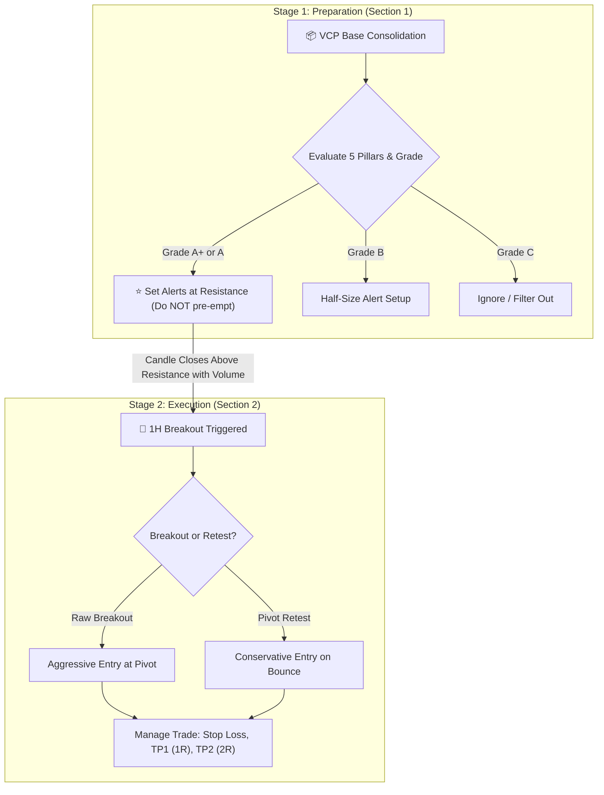
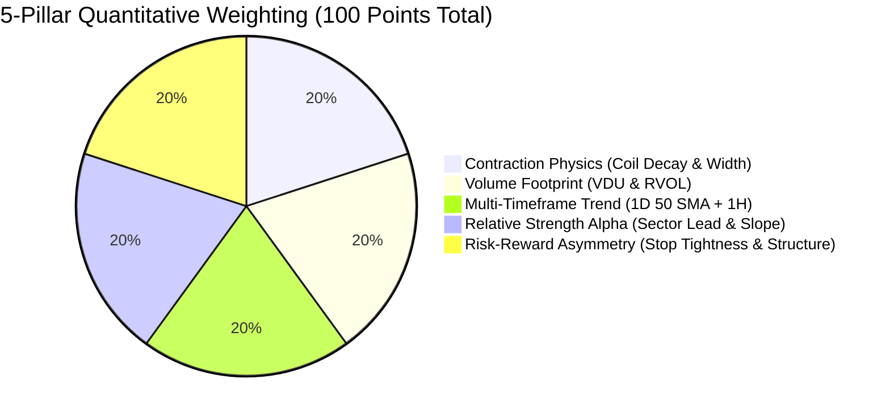

# 📖 Breakout Scanner: Complete Trading & Usage Guide

An institutional trader's operational handbook for interpreting signals, evaluating quantitative conviction grades, and executing high-expectancy trades across **US Equities**, **NSE (India)**, and **Crypto**.

---

## 🧭 1. Overview: The Two-Stage Pipeline

The scanner separates trading into two distinct psychological phases: **Preparation** and **Execution**.



---

## 📦 2. Section 1: Pre-Breakout VCP Bases (Watchlist)

### 🔍 Real Scanner Output Example
```text
• TTWO | Resistance: 212.33 | Support: 201.32 | Width: 5.3% | 🗜️ Coil: 0.1x | 💧 VDU: 0.7x | [Gaming/Media RS: +5.6% ↗] | 🏆 Grade: A [81] | Bias: Strong Upside Bias (3/3)
```

### 🧩 Decoding Every Field

| Diagnostic Flag | Value Example | What It Means | Institutional Significance |
| :--- | :--- | :--- | :--- |
| **Symbol** | `TTWO` | Ticker on watch. | Eligible for trade staging. |
| **Resistance** | `212.33` | The upper ceiling of the base. | Sellers previously capped price here. **Entry trigger line**. |
| **Support** | `201.32` | The lower floor of the base. | Institutional buyers defend price here. Pattern invalidation line. |
| **Width** | `5.3%` | Total base height: $(R - S) / Mid$. | **Sweet spot ($3.5\% - 6.5\%$)**. Provides cheap stops ($< 2\%$). Bases $> 10\%$ are loose and prone to chop. |
| **🗜️ Coil Ratio** | `0.1x` | $\frac{\text{Tight 5-bar range}}{\text{Prior swing range}}$. | Volatility has collapsed by $90\%$ ($0.1\times$). Price is tightly wound like a spring against resistance. |
| **💧 VDU** | `0.7x` | **Volume Dry-Up** ratio. | Recent volume is only $70\%$ of average. Sellers are exhausted; little buying volume will cause rapid expansion. |
| **Sector RS** | `[Gaming RS: +5.6%]` | Trailing 20-bar return vs sector. | TTWO is beating its peer group basket by $+5.6\%$. Institutional rotation is positive. |
| **RS Slope** | `↗` | Linear regression slope of RS line. | • **`↗`**: Alpha is accelerating upward.<br>• **`→`**: Alpha is neutral.<br>• **`↘`**: Alpha is weakening/lagging. |
| **⭐ 1D** | `⭐ 1D Confirmed` | Daily (1D) Macro alignment. | The daily candle is trading above the upward-sloping Daily 50 SMA. **Never take hourly trades against the 1D trend**. |
| **🏆 Quant Grade** | `Grade: A [81]` | 5-Pillar Composite Score ($0–100$). | Quantifies setup quality into tier grades: `A+`, `A`, `B`, or `C`. |
| **Bias** | `Strong Upside (3/3)` | Trend + RS + Macro alignment. | All three foundational filters are green. |

---

### 🎯 How to Make a Decision on Section 1 Setups

```mermaid
flowchart TD
    Start["Ticker appears in Section 1"] --> CheckGrade{"Check Quant Grade"}
    CheckGrade -->|Grade A+ (90-100)| Step1["Top Priority: Ultra-tight coil + VDU + 1D aligned"]
    CheckGrade -->|Grade A (80-89)| Step2["High Conviction: Full standard position size"]
    CheckGrade -->|Grade B (70-79)| Step3["Moderate Conviction: Cut size to 50% or demand retest"]
    
    Step1 --> Action["Set broker alert 0.2% below Resistance"]
    Step2 --> Action
    Step3 --> Action
    
    Action --> Wait["DO NOT buy inside the box! Wait for 1H candle breakout"]
```

1. **Rule #1: Do NOT Buy Inside the Consolidation Box**:
   - The stock is coiled, but it has not broken out yet. Buying early risks capital sitting idle for days while the stock continues to chop.
2. **Rule #2: Set Price Alerts**:
   - For `TTWO` ($R: 212.33$), set a price alert at **`212.00`** on TradingView or your broker terminal.
3. **Rule #3: Sizing Allocation by Grade**:
   - **`Grade A+ / A`**: Prepare full risk allocation ($1.0\% - 2.0\%$ account risk).
   - **`Grade B`**: Prepare half risk allocation ($0.5\% - 1.0\%$ account risk) due to wider base or neutral RS.

---

## 🚀 3. Section 2: Active Signals (Execution & Management)

### 🔍 Real Scanner Output Example
```text
• KO | ▲ BUY [🔄 RETEST] | CP: 88.05 | Entry: 87.78 | Stop: 87.083 | Risk: 0.79% | P&L: +0.31% | [Vol: 1.2x] | [Staples →] | ⭐ 1D | 🏆 A [83] | TP1: 88.477 | TP2: 89.174
```

### 🧩 Decoding Every Field

| Diagnostic Flag | Value Example | What It Means | Actionable Trade Rule |
| :--- | :--- | :--- | :--- |
| **Direction & Type** | `▲ BUY [🔄 RETEST]` | Direction and breakout stage. | • `🚀 BREAKOUT`: Fresh momentum breakout of pivot.<br>• `🔄 RETEST`: Price pulled back, tested broken resistance as support, and bounced. |
| **CP** | `CP: 88.05` | Current live market price. | Where price is trading right now. |
| **Entry** | `Entry: 87.78` | System trigger price. | Compare CP with Entry: If CP is $< 1\%$ from Entry, the trade is still playable. If $> 2.5\%$ extended, do not chase. |
| **Stop** | `Stop: 87.083` | Structural Stop Loss level. | Placed safely beneath the tight coil low or pivot structure. |
| **Risk** | `Risk: 0.79%` | Percentage distance from Entry to Stop. | Extremely tight ($< 1\%$). Allows high position sizing with tiny account risk. |
| **P&L** | `P&L: +0.31%` | Unrealized gain/loss since entry. | Tracks whether the trade is in profit or experiencing initial pullback. |
| **[Vol: X.Xx]** | `[Vol: 1.2x]` | Breakout candle Relative Volume (RVOL). | Breakout candle volume is $1.2\times$ average. Validates institutional participation. |
| **Targets** | `TP1: 88.48 \| TP2: 89.17` | Take-profit milestone levels. | • **TP1**: $1.0R$ target $\rightarrow$ Sell $50\%$, move stop to Breakeven.<br>• **TP2**: $2.0R$ target $\rightarrow$ Sell remaining $50\%$ or trail with 1H 20 SMA. |

---

### 🎯 How to Make a Decision on Section 2 Signals

```mermaid
flowchart TD
    Signal["New Signal Appears in Section 2"] --> ChasingCheck{"Is Current Price <= 1.0% from Entry?"}
    ChasingCheck -->|Yes| CheckVol{"Is RVOL >= 1.2x and Grade A/A+?"}
    ChasingCheck -->|No (> 1.5% extended)| WaitPullback["DO NOT CHASE! Wait for a 🔄 RETEST pullback"]
    
    CheckVol -->|Yes| Execute["Execute Market / Limit Order"]
    CheckVol -->|No (RVOL < 1.0x or Grade C)| Skip["Skip trade (Low institutional commitment)"]
    
    Execute --> PlaceOrders["Immediately place Stop Loss and OCO Target Orders"]
    PlaceOrders --> Monitor{"Price reaches TP1 (1R)?"}
    Monitor -->|Yes| LockProfit["Close 50% position, move Stop to Breakeven (+0.1%)"]
    Monitor -->|No| HoldStop["Let stop loss protect capital"]
```

---

## 📊 4. The 5-Pillar Scoring Matrix (0–100 Points)

Every asset in the scanner is quantitatively evaluated across 5 institutional dimensions:



### 1. Contraction Physics (Max 20 pts)
* **Base Width**: $\le 4.0\%$ ($+10$ pts), $\le 6.5\%$ ($+8$ pts), $\le 9.0\%$ ($+5$ pts), $> 9.0\%$ ($+2$ pts).
* **Coil Tightness Ratio**: $\le 0.40\times$ ($+10$ pts), $\le 0.70\times$ ($+8$ pts), $\le 0.85\times$ ($+5$ pts), uncompressed ($+2$ pts).

### 2. Volume Footprint (Max 20 pts)
* **Base Stage (VDU)**: $\le 0.60\times$ ($+20$ pts), $\le 0.75\times$ ($+16$ pts), $\le 0.90\times$ ($+11$ pts).
* **Breakout Stage (RVOL)**: $\ge 2.0\times$ ($+20$ pts), $\ge 1.5\times$ ($+17$ pts), $\ge 1.2\times$ ($+14$ pts), $\ge 1.0\times$ ($+10$ pts).

### 3. Multi-Timeframe Trend Template (Max 20 pts)
* **Daily (1D) Macro**: Price above rising Daily 50 SMA `⭐ 1D` ($+12$ pts).
* **Hourly (1H) Trend**: Price above 1H 50 SMA ($+8$ pts).

### 4. Relative Strength Alpha & Momentum Slope (Max 20 pts)
* **Sector RS Delta**: $\ge +3.0\%$ ($+10$ pts), $> 0.0\%$ ($+8$ pts), $\ge -2.0\%$ ($+5$ pts).
* **Linear Regression Slope**: `↗` ($+10$ pts), `→` ($+6$ pts), `↘` ($+1$ pt).

### 5. Risk-Reward Asymmetry & Pattern Quality (Max 20 pts)
* **Risk Tightness**: Stop risk $\le 1.2\%$ ($+12$ pts), $\le 2.0\%$ ($+9$ pts), $\le 3.0\%$ ($+6$ pts).
* **Structure Quality**: Confirmed pivot retest ($+8$ pts), clean breakout ($+6$ pts).

---

## 🏆 5. Conviction Tiers & Trade Sizing

| Tier | Score | Color | Trading Conviction | Execution Strategy |
| :---: | :---: | :---: | :--- | :--- |
| **`A+`** | **90 – 100** | 🟢 **Green** | **Institutional "God-Tier"** | Ultra-compressed coil, zero supply (VDU), 1D macro aligned, accelerating sector alpha. **Full position size ($1.5\% - 2.0\%$ risk).** |
| **`A`** | **80 – 89** | 🔵 **Blue** | **High Conviction Breakout** | Prime VCP structure with strong volume and sector support. **Standard full size ($1.0\%$ risk).** |
| **`B`** | **70 – 79** | 🟡 **Yellow** | **Playable Standard Setup** | Sound base, but wider width or neutral relative strength. **Half position size ($0.5\%$ risk); prefer retests.** |
| **`C`** | **< 70** | 🔴 **Red** | **Filtered / Sub-optimal** | Loose base, lacking volume, or counter to daily trend. **Skip completely.** |

---

## 🖥️ 6. Quick Execution Commands

### Run Scan with Immediate Telegram Delivery
```bash
# Default watchlist (US & Crypto)
python3 scan_now.py --watchlist config/watchlist.txt

# Custom watchlist (e.g. NSE India stocks)
python3 scan_now.py --watchlist config/nse_watchlist.txt
```

### Run Daily Pre-Market Briefing
```bash
python3 daily_report.py --watchlist config/watchlist.txt
```

### Launch Interactive Local Dashboard
```bash
python3 dashboard.py
```
*Visit `http://127.0.0.1:5000` to inspect charts and interactive trade cards.*

---

## ⚡ 7. The Golden Rules of Breakout Execution
1. **Never buy an hourly breakout against the Daily 50 SMA** $\rightarrow$ Always check for `⭐ 1D`.
2. **Never buy a breakout on dry volume** $\rightarrow$ Demand `[Vol: >= 1.2x]`.
3. **Never chase an entry that is more than $1.5\%$ above the pivot level** $\rightarrow$ If extended, wait for the `[🔄 RETEST]`.
4. **Take $50\%$ profit at TP1 ($1.0R$) and move stop to Breakeven ($+0.1\%$)** $\rightarrow$ Guarantees you never let a winning trade turn into a losing trade.
